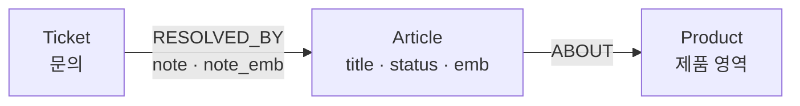

# 튜토리얼: 그래프 안에서 의미로 찾기 — 노드와 관계의 벡터·하이브리드 검색

> **이 문서가 답하는 질문**
> - 임베딩을 노드뿐 아니라 **관계**에도 붙이려면 무엇을 선언하고, 관계의 "이유"를 어떻게 검색하는가?
> - 유사도 검색과 그래프 패턴·프로퍼티 조건을 **한 질의**에 쓰면 조건은 top-k를 자르기 전에 적용되는가?
> - 벡터 순위와 그래프 근접도를 합친 하이브리드 순위는 어떤 식으로 계산되고, 각 점수를 따로 볼 수 있는가?
> - 원문이 바뀐 임베딩은 어떻게 찾아내며, 이 기능이 아직 하지 않는 것은 무엇인가?

처음이라면 데모 영상부터 보세요. Studio에서 문서 검색이 놓친 답을 관계 검색이 찾는 과정을 실제로 실행한 화면이고, 설명은 자막으로 들어 있습니다.
이 문서는 [PDF](vector-search-tutorial.pdf) 와 [Word 문서](vector-search-tutorial.docx) 로도 받을 수 있습니다.

[데모 영상 — 문서 검색이 놓친 답을 관계 검색이 찾는 과정](media/vector-search-demo.mp4)

쇼핑몰 고객지원팀의 지식 베이스입니다. 도움말 문서(`Article`)는 제품 영역(`Product`)에 속하고, 처리된
문의(`Ticket`)는 자신을 해결한 문서를 `RESOLVED_BY` 관계로 가리킵니다. 상담원은 그 관계에 **왜 이 문서로
해결됐는지**를 메모(`note`)로 남깁니다.



임베딩은 두 곳에 있습니다. 문서의 `emb` 는 **문서가 무엇에 관한 것인지**, 관계의 `note_emb` 는 **그 문의가
왜 그 문서로 풀렸는지**를 나타냅니다. 둘은 다른 정보입니다. 이 튜토리얼의 중심 사례는 다음 한 건입니다.

> "결제가 계속 실패해요"(T2)라는 문의는 **비밀번호 재설정 문서**(A1)로 해결됐습니다. 세션이 만료돼 결제 인증이
> 막혔던 것입니다. 문서 A1에는 결제라는 말이 없습니다. 이 사실은 관계의 메모에만 있습니다.

**이 문서의 벡터는 손으로 만든 3차원입니다.** 이 환경에는 임베딩 모델이 없습니다. 눈으로 검산할 수 있도록
세 축에 뜻을 정했습니다. 실제로는 임베딩 모델이 문장을 수백~수천 차원의 벡터로 바꿔 주며, 선언에서 차원 수만
달라집니다.

| 축 | 뜻 | 예 |
|---|---|---|
| 1 | 계정·로그인 | `[1,0,0]` = "로그인이 안 됩니다" |
| 2 | 결제 | `[0,1,0]` = "결제가 안 됩니다" |
| 3 | 배송 | `[0,0,1]` = "배송이 안 옵니다" |

유사도는 코사인입니다. 방향이 같으면 1, 직각이면 0입니다. `[0.6,0.8,0]` 은 "결제 문제인데 계정도 얽혀 있다"는 방향입니다.

## 준비

이 문서의 출력은 손으로 적은 것이 아닙니다. `python3 examples/tutorials/build_tutorial.py vector-search` 가
[원본](../../examples/tutorials/vector-search/tutorial.src.md) 의 블록을 빈 데이터베이스에서 차례로 실행해 끼워 넣습니다.

```sql
SELECT og_create_graph('support');
```

## 1단계. 임베딩을 선언한다 — 노드에도, 관계에도

임베딩은 별도 저장소가 아니라 데이터 타입이 `vector(N)` 인 **프로퍼티**입니다. 선언하는 길은 둘입니다.
문서의 임베딩은 사이퍼로 선언합니다. Neo4j와 같은 문장입니다.

```cypher
CREATE VECTOR INDEX article_emb FOR (a:Article) ON (a.emb)
OPTIONS {indexConfig: {`vector.dimensions`: 3, `vector.similarity_function`: 'cosine'}}
```

관계의 임베딩은 SQL 함수로 선언합니다. 마지막 인자 `'note'` 는 이 임베딩이 **어느 프로퍼티에서 만들어졌는지**
이며, 7단계에서 낡은 임베딩을 찾는 데 쓰입니다. 사이퍼 문장에는 이 인자를 줄 자리가 없습니다.

```sql
SELECT og_create_type('support', 'RESOLVED_BY', 'relation');
SELECT og_add_property('support', 'RESOLVED_BY', 'note', 'string');
SELECT og_add_embedding('support', 'RESOLVED_BY', 'note_emb', 3, 'cosine', 'note');
```

두 선언은 같은 카탈로그(`og_catalog.embedding`)에 들어가고, 각 타입의 테이블에 `vector(3)` 컬럼과 HNSW 인덱스가
생깁니다. `n_` 은 노드 테이블, `e_` 는 관계 테이블입니다.

```sql
SELECT t.name AS type, CASE t.kind WHEN 'e' THEN 'node' ELSE 'relationship' END AS kind,
       e.prop, e.dims, e.metric, e.source_prop, i.tablename, i.indexname
  FROM og_catalog.embedding e
  JOIN og_catalog.type t USING (type_id)
  JOIN pg_indexes i ON i.indexname = 'hnsw_' || e.type_id || '_p_' || e.prop
 ORDER BY 1;
```

```text
    type     |     kind     |   prop   | dims | metric | source_prop | tablename |     indexname
-------------+--------------+----------+------+--------+-------------+-----------+-------------------
 Article     | node         | emb      |    3 | cosine |             | n_1       | hnsw_1_p_emb
 RESOLVED_BY | relationship | note_emb |    3 | cosine | note        | e_2       | hnsw_2_p_note_emb
(2 rows)
```

관계에도 `FOR ()-[r:RESOLVED_BY]-() ON (r.note_emb)` 형태의 `CREATE VECTOR INDEX` 를 쓸 수 있습니다. 다만 이미
선언된 프로퍼티에 다른 쪽 방법을 다시 실행하면 `duplicate key` 오류가 나므로, 한 프로퍼티에는 한 방법만 씁니다.

## 2단계. 데이터를 넣는다

벡터는 `'[1,0,0]'` 형태의 문자열로 씁니다. 문서 6건, 문의 6건입니다.

```cypher
CREATE (acct:Product {name: '계정'}), (pay:Product {name: '결제'}), (ship:Product {name: '배송'})
CREATE (a1:Article {code: 'A1', title: '비밀번호 재설정 방법', status: 'published', emb: '[1,0,0]'})-[:ABOUT]->(acct)
CREATE (a2:Article {code: 'A2', title: '2단계 인증 설정', status: 'draft', emb: '[0.9,0.1,0]'})-[:ABOUT]->(acct)
CREATE (a3:Article {code: 'A3', title: '카드 결제 오류 해결', status: 'published', emb: '[0.1,0.9,0]'})-[:ABOUT]->(pay)
CREATE (a4:Article {code: 'A4', title: '환불 절차 안내', status: 'published', emb: '[0,0.9,0.3]'})-[:ABOUT]->(pay)
CREATE (a5:Article {code: 'A5', title: '배송 조회 방법', status: 'published', emb: '[0,0,1]'})-[:ABOUT]->(ship)
CREATE (a6:Article {code: 'A6', title: '해외 배송 관세 안내', status: 'published', emb: '[0,0.4,0.9]'})-[:ABOUT]->(ship)
CREATE (:Ticket {code: 'T1', title: '로그인이 안 돼요'})-[:RESOLVED_BY {note: '비밀번호 분실. 재설정으로 해결', note_emb: '[1,0,0]'}]->(a1)
CREATE (:Ticket {code: 'T2', title: '결제가 계속 실패해요'})-[:RESOLVED_BY {note: '세션 만료로 결제 인증이 막힘. 비밀번호 재설정 후 결제 성공', note_emb: '[0.6,0.8,0]'}]->(a1)
CREATE (:Ticket {code: 'T3', title: '카드 승인이 거절돼요'})-[:RESOLVED_BY {note: '카드 한도 초과. 다른 카드로 결제', note_emb: '[0,1,0]'}]->(a3)
CREATE (:Ticket {code: 'T4', title: '환불이 안 들어와요'})-[:RESOLVED_BY {note: '환불은 영업일 3일이 걸린다고 안내', note_emb: '[0,0.9,0.2]'}]->(a4)
CREATE (:Ticket {code: 'T5', title: '택배가 안 와요'})-[:RESOLVED_BY {note: '송장 조회로 배송 지연 확인', note_emb: '[0,0,1]'}]->(a5)
CREATE (:Ticket {code: 'T6', title: '해외 주문에 추가 요금이 붙었어요'})-[:RESOLVED_BY {note: '관세는 수령할 때 따로 결제한다고 안내', note_emb: '[0,0.5,0.8]'}]->(a6)
```

```cypher
MATCH (a:Article)-[:ABOUT]->(p:Product)
RETURN a.code AS code, a.title AS title, p.name AS product, a.status AS status, a.emb AS emb ORDER BY code
```

```text
 code | title                | product | status    | emb
------+----------------------+---------+-----------+-------------
 A1   | 비밀번호 재설정 방법 | 계정    | published | [1,0,0]
 A2   | 2단계 인증 설정      | 계정    | draft     | [0.9,0.1,0]
 A3   | 카드 결제 오류 해결  | 결제    | published | [0.1,0.9,0]
 A4   | 환불 절차 안내       | 결제    | published | [0,0.9,0.3]
 A5   | 배송 조회 방법       | 배송    | published | [0,0,1]
 A6   | 해외 배송 관세 안내  | 배송    | published | [0,0.4,0.9]
(6 rows)
```

```cypher
MATCH (t:Ticket)-[r:RESOLVED_BY]->(a:Article)
RETURN t.code AS ticket, t.title AS title, a.code AS article, r.note AS note, r.note_emb AS note_emb ORDER BY ticket
```

```text
 ticket | title                            | article | note                                                       | note_emb
--------+----------------------------------+---------+------------------------------------------------------------+-------------
 T1     | 로그인이 안 돼요                 | A1      | 비밀번호 분실. 재설정으로 해결                             | [1,0,0]
 T2     | 결제가 계속 실패해요             | A1      | 세션 만료로 결제 인증이 막힘. 비밀번호 재설정 후 결제 성공 | [0.6,0.8,0]
 T3     | 카드 승인이 거절돼요             | A3      | 카드 한도 초과. 다른 카드로 결제                           | [0,1,0]
 T4     | 환불이 안 들어와요               | A4      | 환불은 영업일 3일이 걸린다고 안내                          | [0,0.9,0.2]
 T5     | 택배가 안 와요                   | A5      | 송장 조회로 배송 지연 확인                                 | [0,0,1]
 T6     | 해외 주문에 추가 요금이 붙었어요 | A6      | 관세는 수령할 때 따로 결제한다고 안내                      | [0,0.5,0.8]
(6 rows)
```

T2의 문서는 A1 `[1,0,0]` 인데 메모의 벡터는 `[0.6,0.8,0]` 입니다. 문서와 해결 이유가 다른 방향을 봅니다.
선언한 차원과 다른 벡터는 거부됩니다.

```cypher
CREATE (:Article {code: 'A9', title: '차원이 다른 문서', emb: '[1,0]'})
```

```text
ERROR:  expected 3 dimensions, not 2
```

## 3단계. 노드를 의미로 찾는다

"로그인이 안 됩니다" `[1,0,0]` 과 가까운 문서 셋을 찾습니다. 질의 벡터는 파라미터 `$q` 로 넘깁니다.

```cypher
CALL db.index.vector.queryNodes('article_emb', 3, $q) YIELD node, score
RETURN node.code AS code, node.title AS title, round(toFloat(score) * 1000) / 1000 AS score
```

```text
 code | title                | score
------+----------------------+-------
 A1   | 비밀번호 재설정 방법 | 1.0
 A2   | 2단계 인증 설정      | 0.994
 A3   | 카드 결제 오류 해결  | 0.11
(3 rows)
```

검산: A2 `[0.9,0.1,0]` 의 코사인은 0.9 ÷ √(0.81+0.01) = 0.994, A3 `[0.1,0.9,0]` 은 0.1 ÷ √0.82 = 0.110 입니다.
(`YIELD` 로 받은 `score` 에 바로 산술을 하면 오류가 나서 `toFloat` 을 거쳤습니다.)

`queryNodes` 가 돌려준 노드에서 그래프 패턴을 바로 이어 갈 수 있습니다. 벡터로 들어가 관계로 나오는 질의입니다.
가장 가까운 문서 하나와, 그 문서로 해결된 문의를 함께 가져옵니다.

```cypher
CALL db.index.vector.queryNodes('article_emb', 1, $q) YIELD node, score
MATCH (t:Ticket)-[r:RESOLVED_BY]->(node)
RETURN node.code AS article, t.code AS ticket, t.title AS title, r.note AS note ORDER BY ticket
```

```text
 article | ticket | title                | note
---------+--------+----------------------+------------------------------------------------------------
 A1      | T1     | 로그인이 안 돼요     | 비밀번호 분실. 재설정으로 해결
 A1      | T2     | 결제가 계속 실패해요 | 세션 만료로 결제 인증이 막힘. 비밀번호 재설정 후 결제 성공
(2 rows)
```

같은 검색을 함수로도 씁니다. `vector.similarity(a, b)` 는 pgvector의 `1 - (a <=> b)` 로 컴파일됩니다.
`vector.distance` 는 코사인 거리(1 − 유사도), `vector.l2` 는 유클리드 거리입니다.

```cypher
MATCH (a:Article)
RETURN a.code AS code, round(vector.similarity(a.emb, $q) * 1000) / 1000 AS similarity,
       round(vector.distance(a.emb, $q) * 1000) / 1000 AS distance, round(vector.l2(a.emb, $q) * 1000) / 1000 AS l2
ORDER BY similarity DESC LIMIT 3
```

```text
 code | similarity | distance | l2
------+------------+----------+-------
 A1   | 1.0        | 0.0      | 0.0
 A2   | 0.994      | 0.006    | 0.141
 A3   | 0.11       | 0.89     | 1.273
(3 rows)
```

이 함수들에 질의 벡터를 줄 때는 파라미터나 `'[1,0,0]'` 문자열을 씁니다. 리스트 리터럴 `[1, 0, 0]` 을 직접 쓰면
`cannot cast type jsonb to vector` 오류가 납니다(`queryNodes` 의 세 번째 인자는 리스트 리터럴도 받습니다).

## 4단계. 관계를 의미로 찾는다

새 문의입니다. "결제가 안 되는데 계정 쪽 문제 같아요" — 벡터로는 `[0.6,0.8,0]` 입니다. 먼저 문서에서 찾습니다.

```cypher
MATCH (a:Article)
RETURN a.code AS code, a.title AS title, round(vector.similarity(a.emb, $q) * 1000) / 1000 AS score
ORDER BY score DESC LIMIT 3
```

```text
 code | title               | score
------+---------------------+-------
 A3   | 카드 결제 오류 해결 | 0.861
 A4   | 환불 절차 안내      | 0.759
 A2   | 2단계 인증 설정     | 0.685
(3 rows)
```

결제 문서 둘과 2단계 인증 문서가 나오고, 실제로 이런 문의를 해결했던 A1(유사도 0.6)은 셋 안에 없습니다.
이번에는 같은 벡터로 **관계**를 찾습니다. 임베딩이 관계의 프로퍼티이므로 패턴 안의 `r` 에 그대로 씁니다.

```cypher
MATCH (t:Ticket)-[r:RESOLVED_BY]->(a:Article)
RETURN t.title AS ticket, a.title AS article, r.note AS why, round(vector.similarity(r.note_emb, $q) * 1000) / 1000 AS score
ORDER BY score DESC LIMIT 3
```

```text
 ticket               | article              | why                                                        | score
----------------------+----------------------+------------------------------------------------------------+-------
 결제가 계속 실패해요 | 비밀번호 재설정 방법 | 세션 만료로 결제 인증이 막힘. 비밀번호 재설정 후 결제 성공 | 1.0
 카드 승인이 거절돼요 | 카드 결제 오류 해결  | 카드 한도 초과. 다른 카드로 결제                           | 0.8
 환불이 안 들어와요   | 환불 절차 안내       | 환불은 영업일 3일이 걸린다고 안내                          | 0.781
(3 rows)
```

첫 줄이 중심 사례입니다. "결제 실패가 비밀번호 재설정으로 풀렸다"는 사실은 문서에도 문의에도 없고 둘을 잇는
관계에만 있으며, 그 관계를 의미로 찾았습니다. 검산: T3 `[0,1,0]` 은 0.8 ÷ 1 = 0.8, T1 `[1,0,0]` 은 0.6 으로
넷째입니다.

SQL에서는 노드와 같은 함수에 관계 타입 이름을 줍니다. 결과의 `entity` 에 양 끝 노드의 id(`_src`, `_dst`)가
들어 있습니다.

```sql
SELECT round(score::numeric, 3) AS score, entity->>'note' AS note,
       og_node_json((entity->>'_src')::bigint)->>'code' AS ticket, og_node_json((entity->>'_dst')::bigint)->>'code' AS article
  FROM og_vector_search('support', 'RESOLVED_BY', 'note_emb', '[0.6,0.8,0]', 2);
```

```text
 score |                            note                            | ticket | article
-------+------------------------------------------------------------+--------+---------
 1.000 | 세션 만료로 결제 인증이 막힘. 비밀번호 재설정 후 결제 성공 | T2     | A1
 0.800 | 카드 한도 초과. 다른 카드로 결제                           | T3     | A3
(2 rows)
```

"이 해결 사례와 비슷한 다른 사례"는 `og_similar` 입니다. 기준 관계의 id를 주면 자기 자신을 뺀 결과가 옵니다.

```sql
SELECT round(s.score::numeric, 3) AS score, s.entity->>'note' AS note
  FROM og_similar('support',
         (SELECT (r->>'id')::bigint FROM og_cypher('support',
            $$MATCH (:Ticket {code: 'T2'})-[r:RESOLVED_BY]->() RETURN id(r) AS id$$) r),
         'note_emb', 3) s;
```

```text
 score |               note
-------+-----------------------------------
 0.800 | 카드 한도 초과. 다른 카드로 결제
 0.781 | 환불은 영업일 3일이 걸린다고 안내
 0.600 | 비밀번호 분실. 재설정으로 해결
(3 rows)
```

Neo4j의 관계용 프로시저 `db.index.vector.queryRelationships` 는 등록돼 있지 않아 `procedure … is not available`
오류가 납니다. 관계 검색은 위의 패턴 방식이나 `og_vector_search` 를 씁니다.

## 5단계. 유사도·그래프 패턴·프로퍼티 조건을 한 질의로

관계의 유사도, 두 홉의 패턴, 노드의 프로퍼티 조건을 함께 씁니다. "**계정** 영역의 문서로 해결된 사례 가운데
결제 `[0,1,0]` 와 가까운 것".

```cypher
MATCH (t:Ticket)-[r:RESOLVED_BY]->(a:Article)-[:ABOUT]->(p:Product {name: '계정'})
RETURN t.code AS ticket, a.code AS article, r.note AS why, round(vector.similarity(r.note_emb, $q) * 1000) / 1000 AS score
ORDER BY score DESC
```

```text
 ticket | article | why                                                        | score
--------+---------+------------------------------------------------------------+-------
 T2     | A1      | 세션 만료로 결제 인증이 막힘. 비밀번호 재설정 후 결제 성공 | 0.8
 T1     | A1      | 비밀번호 분실. 재설정으로 해결                             | 0.0
(2 rows)
```

전체에서 결제와 가장 가까운 사례는 T3(1.0)이지만 A3은 결제 영역이라 빠지고, 계정 영역의 두 건만 남습니다.

조건이 **언제** 적용되는지가 중요합니다. 고객에게는 공개된 문서만 보여야 합니다. "로그인" `[1,0,0]` 의 상위
둘은 A1과 A2인데 A2는 초안입니다. 상위 2건을 먼저 뽑고 나서 거르면 한 건만 남습니다. `queryNodes` 는 조건을
받지 못하므로(`YIELD … WHERE` 는 구문 오류) 이렇게 뒤에서 거를 수밖에 없습니다.

```cypher
CALL db.index.vector.queryNodes('article_emb', 2, $q) YIELD node, score
WITH node, score WHERE node.status = 'published'
RETURN node.code AS code, node.status AS status, score
```

```text
 code | status    | score
------+-----------+-------
 A1   | published | 1
(1 row)
```

조건을 검색 안에 넣으면 두 건이 채워집니다. 사이퍼에서는 평소처럼 `WHERE` 에 씁니다.

```cypher
MATCH (a:Article) WHERE a.status = 'published'
RETURN a.code AS code, a.title AS title, round(vector.similarity(a.emb, $q) * 1000) / 1000 AS score
ORDER BY score DESC LIMIT 2
```

```text
 code | title                | score
------+----------------------+-------
 A1   | 비밀번호 재설정 방법 | 1.0
 A3   | 카드 결제 오류 해결  | 0.11
(2 rows)
```

SQL 함수에서는 여섯째 인자가 조건입니다. 검색과 같은 릴레이션에 붙는 **SQL 조각**이고, 프로퍼티 `status` 는
컬럼 `v.p_status` 입니다. 문자열 그대로 SQL에 들어가므로 사용자 입력을 이어 붙여 만들면 안 됩니다.

```sql
SELECT entity->>'code' AS code, entity->>'status' AS status, round(score::numeric, 3) AS score
  FROM og_vector_search('support', 'Article', 'emb', '[1,0,0]', 2, $f$v.p_status = 'published'$f$);
```

```text
 code |  status   | score
------+-----------+-------
 A1   | published | 1.000
 A3   | published | 0.110
(2 rows)
```

사이퍼 질의는 조건과 정렬이 같은 릴레이션 위에 있는 SQL 한 문장으로 컴파일됩니다. 그 계획을 봅니다. 여섯
행에서는 PostgreSQL이 순차 탐색을 고르므로 순차 탐색을 끄고 봅니다. HNSW 인덱스를 타는 모양은
`ORDER BY vector.distance(…) LIMIT k` (거리 오름차순)입니다. `ORDER BY vector.similarity(…) DESC` 는 결과는 같지만
인덱스를 쓰지 못하고 전부 계산해 정렬합니다. 조건이 아주 드물게만 통과할 때의 동작은 8단계에 적었습니다.

```sql
SET enable_seqscan = off;
SELECT p->>'Node Type' AS node_type, p->>'Index Name' AS index_name, p->>'Order By' AS order_by, p->>'Filter' AS filter
  FROM (SELECT og_cypher_explain('support', $$MATCH (a:Article) WHERE a.status = 'published'
          RETURN a.code AS code ORDER BY vector.distance(a.emb, '[1,0,0]') LIMIT 2$$)
          -> 'plan' -> 0 -> 'Plan' -> 'Plans' -> 0 AS p) x;
```

```text
 node_type  |  index_name  |                order_by                 |             filter
------------+--------------+-----------------------------------------+--------------------------------
 Index Scan | hnsw_1_p_emb | ((p_emb)::vector <=> '[1,0,0]'::vector) | (p_status = 'published'::text)
(1 row)
```

## 6단계. 하이브리드 순위 — 벡터 순위와 그래프 근접도

"배송받은 상품을 환불하고 싶어요" `[0,1,0.2]`. 벡터만으로는 결제 영역의 환불 문서 A4(0.992)와 카드 결제 문서
A3(0.975)이 위에 옵니다. `og_hybrid_search` 는 여기에 **기준 노드(anchor)와의 그래프 거리**를 더합니다.

이 문의를 **배송** 담당 상담원이 받았다고 합시다. 기준 노드를 `Product` '배송'으로 주면, 그 노드에서 관계를
따라 3홉 안에 있는 문서에 그래프 점수가 더해집니다.

```sql
SELECT h.entity->>'code' AS code, h.entity->>'title' AS title, round(h.vector_score::numeric, 3) AS vector_score,
       round(h.graph_score::numeric, 3) AS graph_score, round(h.score::numeric, 5) AS score
  FROM og_hybrid_search('support', 'Article', 'emb', '[0,1,0.2]',
         (SELECT (r->>'id')::bigint FROM og_cypher('support', $$MATCH (p:Product {name: '배송'}) RETURN id(p) AS id$$) r),
         6) h ORDER BY h.score DESC;
```

```text
 code |        title         | vector_score | graph_score |  score
------+----------------------+--------------+-------------+---------
 A6   | 해외 배송 관세 안내  |        0.577 |       0.500 | 0.03227
 A5   | 배송 조회 방법       |        0.196 |       0.500 | 0.03202
 A4   | 환불 절차 안내       |        0.992 |       0.000 | 0.01639
 A3   | 카드 결제 오류 해결  |        0.975 |       0.000 | 0.01613
 A2   | 2단계 인증 설정      |        0.108 |       0.000 | 0.01538
 A1   | 비밀번호 재설정 방법 |        0.000 |       0.000 | 0.01515
(6 rows)
```

계산식은 RRF(Reciprocal Rank Fusion)입니다. 점수의 크기가 아니라 순위를 더하므로 두 신호의 단위가 달라도 됩니다.

    score = vector_weight × 1/(60 + 벡터 순위) + graph_weight × 1/(60 + 기준 노드까지의 홉 수)
    graph_score = 1/(1 + 홉 수)        (3홉 안에 없으면 그래프 항은 0)

검산: A6은 벡터 3위, 1홉이므로 1/63 + 1/61 = 0.01587 + 0.01639 = 0.03227. A4는 벡터 1위지만 닿지 않으므로
1/61 = 0.01639.

여기서 볼 것이 하나 더 있습니다. 기본 가중치(1, 1)에서는 유사도 0.196인 A5가 0.992인 A4보다 위에 있습니다.
그래프 항 하나(1/61)가 벡터 항 전체와 같은 크기이기 때문에, **기준 노드에 닿는 문서는 닿지 않는 문서를 모두
앞섭니다.** 그래프를 동점 처리 정도로만 쓰려면 가중치를 낮춥니다.

```sql
SELECT h.entity->>'code' AS code, h.entity->>'title' AS title, round(h.vector_score::numeric, 3) AS vector_score,
       round(h.graph_score::numeric, 3) AS graph_score, round(h.score::numeric, 5) AS score
  FROM og_hybrid_search('support', 'Article', 'emb', '[0,1,0.2]',
         (SELECT (r->>'id')::bigint FROM og_cypher('support', $$MATCH (p:Product {name: '배송'}) RETURN id(p) AS id$$) r),
         6, 1.0, 0.02) h ORDER BY h.score DESC;
```

```text
 code |        title         | vector_score | graph_score |  score
------+----------------------+--------------+-------------+---------
 A4   | 환불 절차 안내       |        0.992 |       0.000 | 0.01639
 A6   | 해외 배송 관세 안내  |        0.577 |       0.500 | 0.01620
 A3   | 카드 결제 오류 해결  |        0.975 |       0.000 | 0.01613
 A5   | 배송 조회 방법       |        0.196 |       0.500 | 0.01595
 A2   | 2단계 인증 설정      |        0.108 |       0.000 | 0.01538
 A1   | 비밀번호 재설정 방법 |        0.000 |       0.000 | 0.01515
(6 rows)
```

환불 문서 A4가 다시 1위이고, 배송 영역의 A6이 A3을 근소하게 앞섭니다(0.01587 + 0.02/61 = 0.01620 > 0.01613).
`graph_weight` 를 0으로 주거나 기준 노드를 주지 않으면(`NULL`) `vector_score` 순서 그대로입니다.

## 7단계. 원문이 바뀐 임베딩을 찾는다

엔진은 임베딩을 만들지 않습니다. 대신 1단계에서 `note_emb` 가 `note` 에서 나왔다고 선언했으므로, **다시 만들어야
할 임베딩의 목록**을 줍니다. 임베딩을 계산해 넣은 쪽이 `og_mark_embedded` 로 "지금의 원문으로 만들었다"고
기록합니다. 처음에는 아무것도 기록되지 않았으므로 여섯 관계가 모두 목록에 있습니다.

```sql
SELECT count(*) AS stale_before, count(og_mark_embedded(entity_id, prop)) AS marked FROM og_stale_embeddings('support');
```

```text
 stale_before | marked
--------------+--------
            6 |      6
(1 row)
```

상담원이 T5의 메모를 고칩니다. 벡터는 그대로입니다.

```cypher
MATCH (:Ticket {code: 'T5'})-[r:RESOLVED_BY]->() SET r.note = '택배사 파업으로 배송 지연. 결제 취소 후 환불'
```

```sql
SELECT s.type_name, s.prop, e->>'note' AS note, e->>'note_emb' AS note_emb
  FROM og_stale_embeddings('support') s, og_edge_json(s.entity_id) e;
```

```text
  type_name  |   prop   |                     note                     | note_emb
-------------+----------+----------------------------------------------+----------
 RESOLVED_BY | note_emb | 택배사 파업으로 배송 지연. 결제 취소 후 환불 | [0,0,1]
(1 row)
```

임베딩 파이프라인은 이 목록을 받아 벡터를 다시 계산해 넣고 기록합니다. 그러면 목록이 빕니다.

```sql
SELECT og_cypher('support', $$MATCH (:Ticket {code: 'T5'})-[r:RESOLVED_BY]->() SET r.note_emb = '[0,0.6,0.8]'$$);
SELECT count(og_mark_embedded(entity_id, prop)) AS marked FROM og_stale_embeddings('support');
SELECT s.type_name, s.prop FROM og_stale_embeddings('support') s;
```

```text
 og_cypher
-----------
(0 rows)

 marked
--------
      1
(1 row)

 type_name | prop
-----------+------
(0 rows)
```

벡터만 고치고 `og_mark_embedded` 를 부르지 않으면 목록에 계속 남습니다. 문서의 `emb` 는 사이퍼의
`CREATE VECTOR INDEX` 로 선언해 원문 프로퍼티가 없으므로 추적 대상이 아닙니다.

## 8단계. 이 기능이 하지 않는 것

스펙 004의 작업 목록에서 **FTS(전문검색) 결합**과 **경로·서브그래프 임베딩**은 미완료입니다. 그 밖에 실행해서
확인한 한계는 다음과 같습니다.

**질문 문장을 벡터로 바꾸지 않습니다.** `genai.vector.encode` 는 외부 임베딩 서버를 HTTP로 호출하는 함수이고
기본값은 꺼짐입니다. 이 환경에는 서버가 없어 이 문서에서는 쓰지 않았습니다.

```cypher
RETURN genai.vector.encode('결제가 안 됩니다') AS v
```

```text
ERROR:  genai.vector.encode is disabled. It makes an outbound HTTP request from the database, so it is off until that is chosen deliberately: SELECT og_set_setting('genai.enabled', 'on')
```

**하이브리드 검색은 노드 타입만 받습니다.** 관계 타입을 주면 오류 없이 빈 결과가 옵니다.

```sql
SELECT id, score FROM og_hybrid_search('support', 'RESOLVED_BY', 'note_emb', '[0,1,0]', NULL, 3);
```

```text
 id | score
----+-------
(0 rows)
```

그 밖에 알아 둘 것입니다.

- **임베딩이 없는 행.** `og_vector_search` 와 `queryNodes` 에서는 빠집니다. `vector.similarity` 로 직접 정렬하면
  유사도가 null이 되어 내림차순의 **맨 위**에 옵니다. `WHERE a.emb IS NOT NULL` 을 붙입니다.
- **점수의 방향.** 코사인은 유사도(클수록 가까움)로 돌려줍니다. `l2` 로 선언한 임베딩의 `og_vector_search` 점수와,
  재현율 비교용 `og_vector_search_exact` 의 점수는 **거리**(작을수록 가까움)입니다.
- **선택도가 매우 낮은 조건.** 조건과 인덱스 중 어느 쪽을 탈지는 PostgreSQL 플래너가 비용으로 정합니다. 3만 행 중
  0.1%만 통과하는 조건으로 따로 실험했을 때 플래너는 순차 탐색을 골라 10건을 모두 채웠습니다. HNSW 경로를
  강제하면 0건이었고, pgvector의 `SET hnsw.iterative_scan = relaxed_order` 를 켜면 10건이 됐습니다. 엔진이 탐색
  범위를 스스로 넓히지는 않습니다.
- **`EXPLAIN` 의 벡터 연산자.** 예상 재현율 같은 전용 표시는 없습니다. 5단계처럼 `og_cypher_explain` 으로
  PostgreSQL 계획을 봅니다.
- **키워드 검색.** `CREATE FULLTEXT INDEX` 와 `db.index.fulltext.queryNodes` 는 있지만 벡터 순위와 합쳐 주는
  함수는 없습니다. 또한 `simple` 사전이라 한국어 조사·어미를 분리하지 않습니다("결제" 로 "결제가" 를 찾지 못함).

### 한 장으로 다시 보기

```cypher
// 1. 선언 — 노드
CREATE VECTOR INDEX article_emb FOR (a:Article) ON (a.emb)
OPTIONS {indexConfig: {`vector.dimensions`: 3, `vector.similarity_function`: 'cosine'}}
// 1'. 관계는 SQL로: SELECT og_add_embedding('support', 'RESOLVED_BY', 'note_emb', 3, 'cosine', 'note');
// 2. 노드 검색 → 그래프로 이어 가기
CALL db.index.vector.queryNodes('article_emb', 3, $q) YIELD node, score
MATCH (t:Ticket)-[:RESOLVED_BY]->(node) RETURN node.title, t.title, score
// 3. 관계 검색 + 패턴 + 조건을 한 질의로
MATCH (t:Ticket)-[r:RESOLVED_BY]->(a:Article)-[:ABOUT]->(p:Product {name: '계정'})
WHERE a.status = 'published'
RETURN t.title, a.title, r.note, vector.similarity(r.note_emb, $q) AS score ORDER BY score DESC LIMIT 5
// 인덱스를 타는 모양은 ORDER BY vector.distance(a.emb, $q) LIMIT k
```

```sql
-- 노드·관계 공통 검색(여섯째 인자는 조건) / 비슷한 것 / 하이브리드(노드 타입만) / 다시 만들 목록
SELECT * FROM og_vector_search('support', 'RESOLVED_BY', 'note_emb', '[0.6,0.8,0]', 10, $f$v.p_note IS NOT NULL$f$);
SELECT * FROM og_similar('support', <관계 또는 노드 id>, 'note_emb', 5);
SELECT * FROM og_hybrid_search('support', 'Article', 'emb', '[0,1,0.2]', <기준 노드 id>, 10, 1.0, 0.02);
SELECT * FROM og_stale_embeddings('support');   -- 계산해 넣은 뒤 og_mark_embedded(<id>, 'note_emb')
```

함수 목록은 [`docs/api.md`](../api.md) 의 "Vectors" 절, 사이퍼 함수와 프로시저는 [`docs/cypher.md`](../cypher.md),
미완료 항목은 [스펙 004의 작업 목록](../../specs/004-vector-hybrid-search/tasks.md) 에 있습니다.
