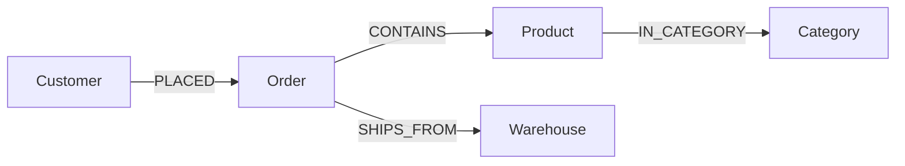

<!-- graph: shop -->
# 튜토리얼: 에이전트를 위한 인터페이스 — 스스로 탐색하고, 틀리면 고치고, 실행 전에 가늠한다

> **이 문서가 답하는 질문**
> - 처음 보는 그래프에서 AI 에이전트는 무엇을 먼저 읽는가? 스키마를 프롬프트에 넣을 크기로 받을 수 있는가?
> - 질의가 틀렸을 때, 그리고 틀리지 않았는데 **0행**일 때 데이터베이스는 무엇을 알려 주는가?
> - 질의를 실행하기 전에 가늠하고, 에이전트가 한 일을 나중에 검토하고, 할 수 있는 일을 제한하려면?
> - 스펙 008이 말하는 것 가운데 지금 실제로 동작하는 것과 그렇지 않은 것은 무엇인가?

처음이라면 데모 영상부터 보세요. Studio에서 에이전트가 스키마를 읽고, 틀리고, 고쳐서 답에 이르는 과정을 실제로 실행한 화면이고, 설명은 자막으로 들어 있습니다.
이 문서는 [PDF](agent-native-tutorial.pdf) 와 [Word 문서](agent-native-tutorial.docx) 로도 받을 수 있습니다.

[데모 영상 — 에이전트가 스키마를 읽고, 틀리고, 고쳐서 답에 이르는 과정](media/agent-native-demo.mp4)

사이퍼를 쓰는 주체가 사람이 아니라 언어 모델이면 실패하는 방식이 다릅니다. 없는 라벨을 지어내고, 화살표를 거꾸로 쓰고,
관계를 빼먹어 카티션 곱을 만듭니다. 스펙 008은 이 실패를 프롬프트가 아니라 **데이터베이스 쪽에서** 줄이려는 기능 묶음이고,
전부 SQL 함수입니다. 이 문서는 에이전트 하나가 질문 하나에 답하는 과정을 따라가며, 단계마다 에이전트가 보내는 호출과
돌려받는 출력을 그대로 보입니다. 작은 쇼핑몰의 주문 그래프에서 운영팀이 묻습니다.

> "지연된 주문은 누가 넣었고, 어느 창고에서 나가나?"



| 주문 | 고객 | 상태 | 창고 | 담긴 상품 |
|---|---|---|---|---|
| O-1001 | 김하늘 | 배송완료 | 이천 | 무선 키보드 |
| O-1002 | 김하늘 | 지연 | 김해 | 모니터 암, 노트북 스탠드 |
| O-1003 | 이도윤 | 지연 | 김해 | 노트북 스탠드 |
| O-1004 | 박서연 | 배송중 | 이천 | 노트북 스탠드 |

답은 표에서 바로 보입니다. O-1002(김하늘)와 O-1003(이도윤), 둘 다 김해 창고입니다. 에이전트는 이 표를 모릅니다.

## 준비

타입과 **역할(role)** 을 선언합니다. 역할은 관계의 어느 쪽 끝에 어떤 타입이 오는지를 적은 것이고, 에이전트가 화살표 방향을
알 수 있는 근거입니다. 사이퍼의 `CREATE` 만으로도 라벨은 생기지만 역할은 생기지 않으므로 이 부분은 SQL입니다.
`og_add_property` 의 다섯째·여섯째 인자는 필수 여부와 키 여부, `og_add_role` 의 마지막 인자는 0이 출발 쪽, 1이 도착 쪽입니다.

```sql run silent
SELECT og_create_graph('shop');
SELECT og_create_type('shop', t, 'entity') FROM unnest(ARRAY['Customer', 'Order', 'Product', 'Category', 'Warehouse']) t;
SELECT og_add_property('shop', 'Customer', 'name', 'string', true, true), og_add_property('shop', 'Customer', 'city', 'string'),
       og_add_property('shop', 'Order', 'order_no', 'string', true, true), og_add_property('shop', 'Order', 'status', 'string'),
       og_add_property('shop', 'Order', 'amount', 'int'), og_add_property('shop', 'Product', 'sku', 'string', true, true),
       og_add_property('shop', 'Product', 'name', 'string'), og_add_property('shop', 'Category', 'name', 'string', true, true),
       og_add_property('shop', 'Warehouse', 'name', 'string', true, true);
SELECT og_create_type('shop', 'PLACED', 'relation'), og_add_role('shop', 'PLACED', 'customer', 'Customer', 0), og_add_role('shop', 'PLACED', 'order', 'Order', 1);
SELECT og_create_type('shop', 'CONTAINS', 'relation'), og_add_role('shop', 'CONTAINS', 'order', 'Order', 0), og_add_role('shop', 'CONTAINS', 'product', 'Product', 1);
SELECT og_create_type('shop', 'IN_CATEGORY', 'relation'), og_add_role('shop', 'IN_CATEGORY', 'product', 'Product', 0), og_add_role('shop', 'IN_CATEGORY', 'category', 'Category', 1);
SELECT og_create_type('shop', 'SHIPS_FROM', 'relation'), og_add_role('shop', 'SHIPS_FROM', 'order', 'Order', 0), og_add_role('shop', 'SHIPS_FROM', 'warehouse', 'Warehouse', 1);
-- 주문의 변경 이력을 남긴다(5단계). 타입마다 켜는 것이고, 켠 뒤의 변경만 기록된다.
SELECT og_enable_history('shop', 'Order');
```

데이터를 넣습니다. O-1002는 `접수` → `배송중` → `지연`, O-1003은 `접수` → `지연` 으로 바뀝니다.

```cypher run silent
CREATE (c1:Customer {name: '김하늘', city: '서울'}), (c2:Customer {name: '이도윤', city: '부산'}), (c3:Customer {name: '박서연', city: '서울'})
CREATE (k1:Category {name: '입력장치'}), (k2:Category {name: '거치대'})
CREATE (p1:Product {sku: 'P-100', name: '무선 키보드'}), (p2:Product {sku: 'P-200', name: '모니터 암'}), (p3:Product {sku: 'P-300', name: '노트북 스탠드'})
CREATE (w1:Warehouse {name: '이천'}), (w2:Warehouse {name: '김해'})
CREATE (o1:Order {order_no: 'O-1001', status: '배송완료', amount: 89000}), (o2:Order {order_no: 'O-1002', status: '접수', amount: 132000}),
       (o3:Order {order_no: 'O-1003', status: '접수', amount: 45000}), (o4:Order {order_no: 'O-1004', status: '배송중', amount: 45000})
CREATE (c1)-[:PLACED]->(o1), (c1)-[:PLACED]->(o2), (c2)-[:PLACED]->(o3), (c3)-[:PLACED]->(o4)
CREATE (o1)-[:CONTAINS]->(p1), (o2)-[:CONTAINS]->(p2), (o2)-[:CONTAINS]->(p3), (o3)-[:CONTAINS]->(p3), (o4)-[:CONTAINS]->(p3)
CREATE (p1)-[:IN_CATEGORY]->(k1), (p2)-[:IN_CATEGORY]->(k2), (p3)-[:IN_CATEGORY]->(k2)
CREATE (o1)-[:SHIPS_FROM]->(w1), (o2)-[:SHIPS_FROM]->(w2), (o3)-[:SHIPS_FROM]->(w2), (o4)-[:SHIPS_FROM]->(w1)
```

```sql run silent
SELECT og_cypher('shop', $$MATCH (o:Order {order_no: 'O-1002'}) SET o.status = '배송중'$$);
SELECT og_cypher('shop', $$MATCH (o:Order) WHERE o.order_no IN ['O-1002', 'O-1003'] SET o.status = '지연'$$);
```

여기서부터가 에이전트의 차례입니다.

## 1단계. 무엇이 있는지 읽는다 — `og_schema`

`og_schema(graph)` 는 그래프의 스키마를 JSON 하나로 돌려줍니다.

```sql run rows=1
SELECT s->>'graph' AS graph, s->>'schema_version' AS schema_version, jsonb_array_length(s->'entity_types') AS entity_types,
       jsonb_array_length(s->'relation_types') AS relation_types, jsonb_array_length(s->'notes') AS notes
  FROM og_schema('shop') s;
```

`schema_version` 은 스키마가 바뀔 때마다 올라가는 번호입니다. 이 번호가 같으면 에이전트는 가지고 있던 스키마를 다시 읽지 않아도 됩니다.
타입마다 프로퍼티와 인스턴스 수가 있고, 관계 타입에는 `roles` 가 있습니다. `PLACED` 하나만 펼쳐 봅니다.

```sql run
\a \t
SELECT jsonb_pretty(t) FROM jsonb_array_elements(og_schema('shop')->'relation_types') t WHERE t->>'name' = 'PLACED';
```

`position` 이 `source` 인 쪽에서 화살표가 나갑니다. 즉 `(:Customer)-[:PLACED]->(:Order)` 입니다. `notes` 는 모델에게 주는 주의 세 줄입니다
(라벨은 하위 타입까지 맞는다, 방향은 `roles` 에서 확인하라, 파라미터는 `$name` 으로).

### 예산을 주면 줄여서 준다 — 다만 토큰을 세지는 않는다

둘째 인자는 토큰 예산입니다. 예산이 모자라면 인스턴스가 많은 타입부터 남기고, **잘랐다는 사실을 응답에 적습니다.**

```sql run rows=1
SELECT s->'truncated'->>'shown' AS shown, s->'truncated'->>'total' AS total, s->'truncated'->>'ordered_by' AS ordered_by,
       NOT (s->'entity_types') @> '[{"name": "Warehouse"}]' AS warehouse_dropped,
       length(s::text) AS chars, length(og_schema('shop')::text) AS chars_without_budget
  FROM og_schema('shop', 240) s;
```

아홉 타입 중 여덟이 남았고, 인스턴스가 가장 적은(2건) 타입 가운데 이름순으로 뒤인 `Warehouse` 가 빠졌습니다. `truncated.hint` 는
`og_schema_for` 를 부르라고 안내합니다. 이 예산은 문자 그대로의 토큰 한도가 아닙니다. 구현은 예산을 30으로 나눈 값을 **타입 개수 상한**으로 쓰고, 그 상한은 8보다 작아지지 않습니다
(`engine/src/agent/mod.rs`). 타입 하나의 실제 JSON은 30토큰보다 훨씬 크므로 응답 크기는 직접 재야 합니다. 위의 두 `chars` 가 그 예입니다.
이 작은 그래프에서는 잘린 응답이 안내문 때문에 오히려 조금 더 깁니다.

### 질문에 필요한 타입만 — `og_schema_for`

질문을 주고 관련된 타입만 받습니다. 방금 빠졌던 `Warehouse` 가 여기서는 들어옵니다.

```sql run rows=2
SELECT q.question, coalesce(s->>'fallback', '-') AS fallback,
       (SELECT string_agg(t->>'name', ', ') FROM jsonb_array_elements(s->'matched_types') t) AS matched_types
  FROM (VALUES (1, 'which warehouse ships the delayed orders, and who placed them?'),
               (2, '지연된 주문은 누가 넣었고 어느 창고에서 나가나?')) q(n, question), og_schema_for('shop', q.question) s
 ORDER BY q.n;
```

선별은 질문의 낱말과 타입·프로퍼티 이름이 **글자로 겹치는지**만 봅니다. 그래서 영어 질문에서도 `Customer` 는 빠졌고("who" 는 있어도
"customer" 는 없습니다), 타입 이름이 영어인 그래프에 한국어로 물으면 아무것도 걸리지 않습니다. 이때는 `fallback` 이 전체 스키마를 읽으라고 말합니다.

## 2단계. 틀린 질의 — 오류가 무엇을 알려 주는가

에이전트가 쓴 질의를 `og_explain_error(graph, query)` 에 넣으면 실행하지 않고 파싱·컴파일만 해 봅니다.
틀렸으면 `code`(재시도 로직이 분기할 수 있는 고정 문자열), `stage`, `message` 를 돌려주고, 맞으면 `{"ok": true}` 입니다.

```sql run rows=5
SELECT q.query, e->>'ok' AS ok, e->>'code' AS code, e->>'stage' AS stage, left(e->>'message', 60) AS message
  FROM (VALUES (1, 'MATCH (o:Order RETURN o.order_no'), (2, 'MATCH (o:Order) RETURN x.order_no'),
               (3, 'MATCH (o:Order) RETURN total(o.amount)'), (4, 'MATCH (o:Order) RETURN sum(o.amount)'),
               (5, 'MATCH (c:Custmer)-[:PLACED]->(o:Order) RETURN c.name')) q(n, query),
       og_explain_error('shop', q.query) e
 ORDER BY q.n;
```

파싱 오류는 위치를 알려 주고, 없는 함수는 지원하는 함수의 목록을 메시지에 붙여 줍니다. 넷째 줄은 맞는 질의입니다.
다섯째 줄은 라벨에 오타가 있는데도 `ok` 입니다. 바로 아래에서 봅니다. 검사 없이 그냥 실행하면 같은 메시지가 오류로 옵니다.

```cypher error
MATCH (o:Order) RETURN total(o.amount)
```

### 없는 라벨은 오류가 아니다

에이전트가 `Customer` 를 `Custmer` 로 썼습니다. **오류가 나지 않고 0행이 돌아옵니다.**

```cypher run rows=0
MATCH (c:Custmer)-[:PLACED]->(o:Order) RETURN c.name AS customer, o.order_no AS order_no
```

Neo4j가 그렇게 동작하고(아직 아무것도 쓰이지 않은 라벨을 묻는 것은 합법입니다), Neo4j 드라이버가 그대로 붙는 것이 이 제품의 목표이기 때문입니다.
가까운 이름은 오류가 아니라 **NOTICE** 로 나갑니다. 아래는 같은 라벨을 `psql` 로 보내고 표준 오류까지 함께 찍은 것입니다(마지막 줄의 0이 행 수).

```sql run
\! psql -XAtq -h localhost -p 28816 -d tut_agent_native -c "SELECT count(*) FROM og_cypher('shop', 'MATCH (c:Custmer) RETURN c.name')" 2>&1 | sed 's/^/psql> /'
```

그래서 위 표의 다섯째 줄처럼 `og_explain_error` 는 이 질의를 문제없다고 봅니다. [`docs/agents.md`](../agents.md) 에는 `UNKNOWN_LABEL` 코드와
`suggestions` 가 돌아오는 예가 있지만, 지금 코드에서 그 코드는 나오지 않습니다.

오타 난 라벨을 잡는 길은 둘입니다. 클라이언트가 NOTICE를 읽거나(`psycopg` 의 `connection.notices`, `node-postgres` 의 `notice` 이벤트),
0행을 받은 뒤 3단계의 `og_diagnose_empty` 를 부르는 것입니다. 없는 프로퍼티(`c.nam`)와 없는 관계 타입(`[:PLACD]`)도 사이퍼에서는
오류가 아니며, 이 둘에는 NOTICE도 없습니다.

**카탈로그 함수**는 다릅니다. 없는 타입 이름을 주면 가까운 이름과 함께 실패합니다. 후보는 실제 카탈로그에서 편집 거리로 고릅니다.

```sql error
SELECT og_enable_history('shop', 'Custmer');
```

## 3단계. 0행의 이유 — `og_diagnose_empty`

라벨을 고친 에이전트가 이번에는 화살표를 거꾸로 썼습니다. 문법도 이름도 맞으므로 오류는 없고, 결과도 없습니다.

```cypher run rows=0
MATCH (o:Order)-[:PLACED]->(c:Customer) RETURN c.name AS customer, o.order_no AS order_no
```

`og_diagnose_empty(graph, query)` 는 패턴을 앞에서부터 한 요소씩 늘려 가며 실제로 세어 보고, 처음 0이 되는 지점을 알려 줍니다.
방금의 질의(1), 2단계의 오타 질의(2), 상태 값을 짐작으로 `'delayed'` 라고 쓴 질의(3)를 차례로 넣습니다.

```sql run rows=8
SELECT q.n, s->>'description' AS step, s->>'rows' AS rows, s->>'verdict' AS verdict, s->>'hint' AS hint
  FROM (VALUES (1, $$MATCH (o:Order)-[:PLACED]->(c:Customer) RETURN c.name$$),
               (2, $$MATCH (c:Custmer)-[:PLACED]->(o:Order) RETURN c.name$$),
               (3, $$MATCH (c:Customer)-[:PLACED]->(o:Order) WHERE o.status = 'delayed' RETURN c.name$$)) q(n, query),
       jsonb_array_elements(og_diagnose_empty('shop', q.query)->'steps') WITH ORDINALITY x(s, i)
 ORDER BY q.n, x.i;
```

- 1번: 주문은 4건인데 `-[:PLACED]->` 를 붙이는 순간 0이 됩니다. 1단계에서 본 `roles` 대로 출발 쪽은 `Customer` 입니다.
  스펙(FR-009)은 "반대 방향에는 N건 있다"까지 요구하지만, 지금은 끊긴 지점과 일반적인 힌트까지입니다.
- 2번: 첫 요소에서 0입니다. 라벨 이름을 의심할 자리가 정해집니다.
- 3번: 패턴은 4행까지 맞았고 `WHERE` 가 전부 지웠습니다.

스키마에는 프로퍼티의 이름과 타입만 있고 **값의 예시는 없습니다**(FR-003의 값 분포는 구현되지 않았습니다). 값은 물어서 확인합니다.

```cypher run rows=3
MATCH (o:Order) RETURN o.status AS status, count(*) AS n ORDER BY n DESC, status
```

검산: 지연 2 + 배송완료 1 + 배송중 1 = 주문 4건. 찾는 값은 `'지연'` 입니다.
`og_diagnose_empty` 는 질의의 **첫 `MATCH` 절만** 따라갑니다. `MATCH` 가 여럿이면 둘째 절의 문제는 보지 못합니다.

## 4단계. 실행 전에 가늠한다 — `og_estimate`

창고까지 붙일 차례입니다. 초안 셋을 `og_estimate` 에 넣어 봅니다. 1번은 주문과 창고 사이의 관계를 빼먹었고, 2번은 고객은 이었지만
창고가 떨어져 있고, 3번은 다 이었습니다. `og_estimate` 는 질의를 실행하지 않습니다. 마지막 열 `actual_rows` 는 독자가 비교할 수 있도록
같은 질의를 따로 실행해 센 값입니다.

```sql run rows=3
SELECT q.n, e->>'would_run' AS would_run, coalesce(e->'advice'->>0, '-') AS advice, e->>'estimated_rows' AS estimated_rows,
       (SELECT count(*) FROM og_cypher('shop', q.query)) AS actual_rows
  FROM (VALUES (1, $$MATCH (o:Order), (w:Warehouse) WHERE o.status = '지연' RETURN o.order_no, w.name$$),
               (2, $$MATCH (c:Customer)-[:PLACED]->(o:Order), (w:Warehouse) WHERE o.status = '지연' RETURN o.order_no, w.name$$),
               (3, $$MATCH (c:Customer)-[:PLACED]->(o:Order)-[:SHIPS_FROM]->(w:Warehouse) WHERE o.status = '지연'
                     RETURN o.order_no, c.name, w.name$$)) q(n, query),
       og_estimate('shop', q.query) e
 ORDER BY q.n;
```

1번은 `would_run` 이 `false` 이고 이유가 `advice` 에 있습니다. 에이전트는 실행하지 않고 고칩니다. 다만 알아 둘 것이 셋 있습니다.

**첫째, 카티션 곱 검사는 관계가 하나도 없는 패턴만 잡습니다.** 2번은 창고가 떨어져 있는데도 통과했습니다.
검산: 1번과 2번의 실제 행 수는 지연 주문 2건 × 창고 2곳 = 4행이고, 절반은 사실이 아닌 조합입니다. 3번만 2행입니다.

**둘째, 숫자는 PostgreSQL 플래너의 추정입니다.** `estimated_rows` 와 `estimated_cost` 는 실행 계획 맨 위 노드의 추정치이고,
실제 행 수와 같지 않습니다. 이렇게 작은 테이블에서는 통계가 없어 특히 그렇습니다. 계획 전체가 필요하면 Studio의 `:explain` 이 쓰는
`og_cypher_explain` 에서 읽습니다.

**셋째, 읽기 질의만 받습니다.** 쓰기 질의는 추정하지 못하고, `og_explain_error` 도 옳은 쓰기 질의를 `COMPILE_ERROR` 로 보고합니다.

```sql run rows=1
SELECT (og_cypher_explain('shop', 'MATCH (o:Order), (w:Warehouse) RETURN o.order_no, w.name', false)
          #>> '{plan,0,Plan,Plan Rows}')::numeric > 0 AS plan_has_row_estimate,
       og_estimate('shop', $$MATCH (o:Order) SET o.status = '취소'$$)->>'error' AS estimate_of_a_write,
       og_explain_error('shop', $$MATCH (o:Order) SET o.status = '취소'$$)->>'code' AS explain_error_of_a_write;
```

3번을 실행합니다. 이것이 답입니다.

```cypher run rows=2
MATCH (c:Customer)-[:PLACED]->(o:Order)-[:SHIPS_FROM]->(w:Warehouse)
WHERE o.status = '지연'
RETURN o.order_no AS order_no, c.name AS customer, w.name AS warehouse ORDER BY order_no
```

검산: 처음의 표와 같습니다. 지연 주문은 둘이고 둘 다 김해 창고에서 나갑니다.

## 5단계. 언제부터 그랬나 — `og_history`

운영팀이 이어서 묻습니다. "O-1002는 처음부터 지연이었나?" 준비 단계에서 `Order` 타입에 이력을 켜 두었으므로 답할 수 있습니다.
`og_history(id)` 는 엔티티 하나의 변경을 최근 것부터 돌려줍니다. `op` 는 `i`(생성) `u`(수정) `d`(삭제)입니다.

```sql run rows=3
SELECT h.op, h.payload->>'p_status' AS status, h.payload->>'p_amount' AS amount
  FROM og_cypher('shop', $$MATCH (o:Order {order_no: 'O-1002'}) RETURN id(o) AS id$$) r, og_history((r->>'id')::bigint) h;
```

접수 → 배송중 → 지연. `payload` 는 그 시점의 행 전체이고, 키는 프로퍼티 이름이 아니라 저장 컬럼 이름(`p_status`)입니다.

이력은 타입마다 켜는 것이고 쓰기 비용이 듭니다. 켜지 않은 타입에 과거 시점을 물으면 `og_as_of` 는 현재 값을 대신 주지 않고 **실패합니다.**
과거를 묻는 질문에 현재 값으로 답하는 쪽이 더 나쁘기 때문입니다. (그래프 전체의 시점 질의는 스펙 013, [temporal 튜토리얼](temporal-tutorial.md).)

```sql error
SELECT og_as_of((r->>'id')::bigint, now() - interval '1 day')
  FROM og_cypher('shop', $$MATCH (c:Customer {name: '김하늘'}) RETURN id(c) AS id$$) r;
```

## 6단계. 에이전트가 한 일 — 감사 로그

`og_cypher` 로 실행된 질의는 `og_data.og_audit` 에 남습니다. 에이전트는 세션에 `og.actor` 와 `og.reason` 을 적어 누가 왜 보낸 질의인지
밝힐 수 있습니다(애플리케이션의 주장이고, `db_user` 가 데이터베이스가 아는 실제 역할입니다).

```sql run rows=1
SET og.actor = 'agent:ops-helper';  SET og.reason = '지연 주문 문의';
SELECT * FROM og_cypher('shop', $$MATCH (o:Order) WHERE o.status = '지연' RETURN count(o) AS delayed$$) \g /dev/null
SELECT audit_id, db_user, coalesce(actor, '-') AS actor, rows_out, left(replace(query, E'\n', ' '), 72) AS query
  FROM og_data.og_audit ORDER BY audit_id;
SELECT count(*) FILTER (WHERE query LIKE '%total(%') AS failed_query_rows,
       count(*) FILTER (WHERE error_code IS NOT NULL) AS rows_with_error_code
  FROM og_data.og_audit;
```

준비 단계의 쓰기 셋, 에이전트가 틀렸던 질의(0행), 4단계에서 비교용으로 실행한 셋, 답을 낸 질의가 순서대로 있습니다. 두 가지는 **남지 않습니다.**

- 진단 호출(`og_schema`, `og_explain_error`, `og_diagnose_empty`, `og_estimate`)은 기록되지 않습니다.
- **실패한 질의는 기록되지 않습니다.** 오류가 나면 감사 행을 쓰기 전에 문장이 중단되고, 이미 쓴 행도 같은 트랜잭션이라 함께 롤백됩니다
  (번호가 건너뛴 자리는 5단계의 실패한 `og_as_of` 문장 안에서 실행된 질의입니다). `error_code` 컬럼은 있지만 채워지지 않습니다.
  2단계에서 오류로 끝난 `total(o.amount)` 질의도 둘째 표가 말하듯 없습니다.

## 7단계. 할 수 있는 일을 제한한다 — 에이전트 역할

`og_create_role(name, limits)` 로 제한 묶음에 이름을 붙여 `og_catalog.agent_role` 에 저장하고, `og_apply_role(name)` 으로 **현재 세션**에 적용합니다.

```sql error
SELECT og_create_role('analyst', '{"statement_timeout_ms": 1000, "work_mem_kb": 4096, "max_rows": 2}');
SELECT og_apply_role('analyst');
SELECT pg_sleep(1.5);
```

시간 제한은 PostgreSQL 세션 설정(`statement_timeout`)으로 걸리고, 실제로 듣습니다. 1초 제한에 1.5초짜리 문장이 취소됐습니다.
`max_rows` 는 **강제되지 않습니다.** `og.max_rows` 라는 설정값으로 저장될 뿐 읽는 코드가 없습니다. 2행 제한을 걸었지만 4행이 옵니다.

```sql run rows=4
SELECT og_apply_role('analyst') AS applied;
SELECT r->>'order_no' AS order_no FROM og_cypher('shop', 'MATCH (o:Order) RETURN o.order_no AS order_no ORDER BY order_no') r;
```

`read_only: true` 는 쓰지 마십시오. 세션을 읽기 전용 트랜잭션으로 만드는데, `og_cypher` 는 읽기 질의에도 감사 행을 쓰므로 **읽기까지 막힙니다.**

```sql error
SELECT og_create_role('reader', '{"read_only": true}');
SELECT og_apply_role('reader');
SELECT * FROM og_cypher('shop', 'MATCH (o:Order) RETURN count(o) AS n');
```

읽기 전용 에이전트는 PostgreSQL 역할과 `og_grant(role, 'read')` (스펙 014)로 만듭니다. 읽기는 되고 감사 행에 그 역할이 남으며,
쓰기는 무엇이 모자란지 알려 주며 거부됩니다. 세션 설정과 달리 에이전트가 스스로 풀 수 없습니다.

```sql run rows=1
DROP ROLE IF EXISTS tut_agent_reader;  CREATE ROLE tut_agent_reader;
SELECT og_grant('tut_agent_reader', 'read') \g /dev/null
SET ROLE tut_agent_reader;
SELECT * FROM og_cypher('shop', 'MATCH (o:Order) RETURN count(o) AS n') \g /dev/null
RESET ROLE;
SELECT db_user, rows_out, query FROM og_data.og_audit ORDER BY audit_id DESC LIMIT 1;
```

```sql error
SET ROLE tut_agent_reader;
SELECT * FROM og_cypher('shop', $$MATCH (o:Order {order_no: 'O-1004'}) SET o.status = '취소'$$);
RESET ROLE;  SELECT og_revoke('tut_agent_reader');  DROP ROLE tut_agent_reader;
```

## 8단계. Studio와 MCP

Studio(`portal/`)의 편집기 명령 셋이 이 기능의 화면입니다. 데모 영상이 이 셋으로 위의 흐름을 다시 밟습니다.

- `:schema` — `og_schema` 의 JSON을 그대로 보여 줍니다(Schema 탭). Storage 탭은 저장 통계입니다.
- `:explain <cypher>` — `og_cypher_explain`. 컴파일된 SQL과 PostgreSQL 계획이고, 행 수 추정은 여기에 있습니다.
- `:why <cypher>` — `og_explain_error`, `og_diagnose_empty`, `og_estimate` 를 한 프레임에 모읍니다.

왼쪽의 **Query log** 패널은 `og_data.og_audit` 의 최근 100건입니다. 오류 메시지에 `did you mean:` 이 있으면 Studio는 후보를 칩으로 보여 줍니다.
다만 2단계에서 본 대로 오타 난 라벨은 오류가 아니라 0행이므로, 그때는 `:why` 를 씁니다.

전용 MCP 서버(스펙 008의 T020)는 **만들어지지 않았습니다.** 대신 Bolt 게이트웨이(스펙 011)가 있어서, Neo4j가 배포하는
[`mcp-neo4j-cypher`](https://github.com/neo4j-contrib/mcp-neo4j) 를 고치지 않고 붙일 수 있습니다. 설정에서 이 제품에 특유한 것은 URI 한 줄입니다.

```json
{ "mcpServers": { "ontological": { "command": "uvx",
    "args": ["mcp-neo4j-cypher", "--db-url", "bolt://localhost:7687", "--username", "dev", "--password", "dev",
             "--database", "shop", "--schema-sample-size", "1000"] } } }
```

`--database` 는 PostgreSQL 데이터베이스가 아니라 **그래프 이름**입니다. 그 서버의 도구는 `get_neo4j_schema`, `read_neo4j_cypher`,
`write_neo4j_cypher` 셋이고, 스키마 도구가 부르는 `apoc.meta.schema()` 는 표본이 아니라 카탈로그(준비 단계에서 선언한 타입과 역할)를 읽습니다.
이 문서의 빌드는 Bolt 게이트웨이를 띄우지 않으므로 **이 부분은 실행해 보이지 않았습니다.** 실행되는 예제와 11항목 호환성 검사(`verify_mcp.py`)는
[`examples/meeting-rooms/`](../../examples/meeting-rooms/) 에 있습니다. 이 문서의 `og_*` 진단 함수는 그 MCP 서버의 도구가 아니며,
SQL 연결이나 Studio의 HTTP API(`/api/schema`, `/api/diagnose`, `/api/explain`)로 부릅니다.

## 아직 안 되는 것

| 스펙 008이 말하는 것 | 지금 |
|---|---|
| 없는 라벨·프로퍼티·관계 타입에 오류 코드와 후보 | 라벨만 NOTICE로 후보가 나간다. `og_explain_error` 는 `ok: true` (2단계) |
| 방향 오류에 "반대 방향 N건" (FR-009) | 끊긴 지점과 일반 힌트까지 (3단계) |
| 토큰 예산 | 타입 개수 상한으로 환산. 최소 8개 (1단계) |
| 값 분포·대표 값 (FR-003), 질의 템플릿 (FR-006) | 없음. 인스턴스 수만 |
| 결과 행 상한 `max_rows`, 방문 노드 상한 (T011) | 강제되지 않음 (7단계) |
| 역할의 `read_only` | 읽기까지 막힘. `og_grant` 로 대신 (7단계) |
| 실패한 질의의 감사 기록, 반복 실패 속도 제한 (T012) | 없음 (6단계) |
| 결과의 출처 추적·추론 근거 (T014, T015) | 없음. 엔티티에 출처를 붙이는 `og_set_source` 만 있다 |
| 전용 MCP 서버 (T020) | 없음. Neo4j MCP 서버 + Bolt로 대신 (8단계) |

### 한 장으로 다시 보기

```sql
-- 1. 읽는다: roles 로 화살표 방향, schema_version 으로 캐시. 예산을 주면 "truncated" (예산÷30 = 타입 개수, 최소 8)
SELECT og_schema('shop');  SELECT og_schema('shop', 4000);
SELECT og_schema_for('shop', 'delayed orders warehouse');   -- 글자 겹침으로 고른다. 타입 이름과 같은 언어로
-- 2. 실행 전에 검사한다 (읽기 질의만)
SELECT og_explain_error('shop', $$MATCH …$$);   -- {ok} 또는 {code, stage, message}
SELECT og_estimate('shop', $$MATCH …$$);        -- would_run, advice, 플래너의 예상 행 수·비용
-- 3. 실행한다. 0행이면 이유를 묻는다
SELECT * FROM og_cypher('shop', $$MATCH …$$);
SELECT og_diagnose_empty('shop', $$MATCH …$$);  -- 단계별 행 수, 끊긴 지점 또는 "WHERE 가 지웠다"
-- 4. 과거를 본다 (타입에 이력을 켠 뒤부터). og_as_of 는 이력이 없으면 오류
SELECT og_enable_history('shop', 'Order');  SELECT * FROM og_history(<id>);  SELECT og_as_of(<id>, <시각>);
-- 5. 운영자: 검토하고 제한한다. 감사에는 성공한 og_cypher 만 남는다. max_rows·read_only 는 기대하지 말 것
SET og.actor = 'agent:…';  SELECT * FROM og_data.og_audit ORDER BY at DESC;
SELECT og_create_role('analyst', '{"statement_timeout_ms": 5000, "work_mem_kb": 65536}');  SELECT og_apply_role('analyst');
CREATE ROLE agent_ro;  SELECT og_grant('agent_ro', 'read');   -- 읽기 전용은 이쪽
-- Studio 에서는  :schema   :explain <cypher>   :why <cypher>
```
