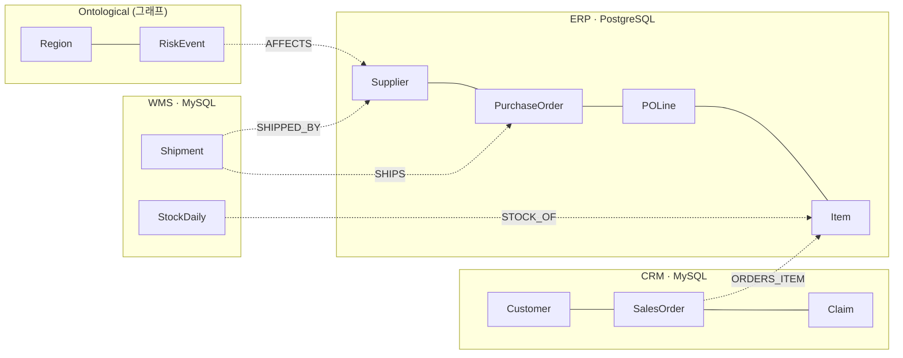

# 튜토리얼: 사이퍼 하나로 여러 DB 조인하기 — 가상 패브릭

> **이 문서가 답하는 질문**
> - 다른 DB에 있는 테이블을 **복사하지 않고** 그래프 노드로 질의하려면 무엇을 선언해야 하는가?
> - PostgreSQL과 MySQL에 나뉜 데이터를 **사이퍼 패턴 하나로** 조인하면 실제로 어디서 무엇이 실행되는가?
> - 그래프에 저장된 노드와 원천 DB의 행을 한 질의에서 섞을 수 있는가?
> - 이 모든 것을 Ontological Studio에서, 사이퍼 편집기 하나로 할 수 있는가?

처음이라면 2분 남짓의 데모 영상부터 보세요. Studio에서 이 문서의 흐름을 빈 데이터베이스부터 실제로 실행한 화면이고,
설명은 자막으로 들어 있습니다. 이 문서는 [PDF](virtual-fabric-tutorial.pdf) 와 [Word 문서](virtual-fabric-tutorial.docx) 로도 받을 수 있습니다.

[데모 영상 — 세 시스템의 데이터를 복사 없이, 사이퍼 하나로 (2분 23초)](media/virtual-fabric-demo.mp4)

회사에 시스템이 셋 있습니다. 같은 것을 서로 다르게 부릅니다.

| 시스템 | DB | 테이블 | 공급사 키 | 발주 키 | 품목 키 |
|---|---|---|---|---|---|
| ERP (구매) | PostgreSQL | `supplier` `purchase_order` `po_line` `item` | `supplier_id` | `po_id` | `item_id` |
| WMS (물류) | MySQL | `shipment` `stock_daily` | `vendor_code` | `ref_po_no` | `sku_code` |
| CRM (고객) | MySQL | `customer` `sales_order` `claim` | — | — | `sku_code` |

이 튜토리얼이 끝나면 아래 질문을 사이퍼 한 번으로 묻게 됩니다. 세 시스템의 데이터는 한 행도 복사되지 않습니다.

> "동아시아에 리스크가 걸린 공급사의, 아직 도착하지 않은 선적은?"
> (리스크는 그래프에, 공급사는 ERP에, 선적은 WMS에 있습니다.)



실선은 한 DB 안의 관계, 점선은 **DB를 넘는 관계**입니다. 이 튜토리얼의 주제는 점선입니다.

개념은 셋뿐이고, 셋 다 사이퍼 편집기에 치는 문장입니다.

| 개념 | 문장 | 한 줄 설명 |
|---|---|---|
| 데이터소스 | `CREATE DATASOURCE` | 외부 DB 하나. 등록하면 그 테이블이 `데이터소스.테이블` 로 보인다 |
| 가상 노드 | `CREATE VIRTUAL NODE` | 테이블(또는 조인 질의)을 노드 라벨로 노출한다. 데이터는 원천에 그대로 있다 |
| 가상 관계 | `CREATE VIRTUAL RELATIONSHIP` | `(a)-[:R]->(b)` 는 `a.x = b.y` 라는 선언. 저장된 간선이 아니라 **조인**이다 |

설계 배경과 다른 방식과의 비교는
[ADR-029](../99_decisions/ADR-029-virtual-fabric-via-fdw.md) 에 있습니다.

## 준비

원천 DB 두 대는 [`examples/tutorials/virtual_fabric/docker-compose.yml`](../../examples/tutorials/virtual_fabric/docker-compose.yml)
로 띄웁니다. 테이블마다 3~10행뿐이라 결과를 눈으로 검산할 수 있습니다
(데이터: [`sources/erp.sql`](../../examples/tutorials/virtual_fabric/sources/erp.sql),
[`sources/wms_crm.sql`](../../examples/tutorials/virtual_fabric/sources/wms_crm.sql)).

```bash
# 1) 원천: PostgreSQL(ERP) 1대 + MySQL(WMS·CRM) 1대. 호스트 포트는 열지 않는다.
docker compose -f examples/tutorials/virtual_fabric/docker-compose.yml up -d

# 2) Ontological 컨테이너(이 문서에서는 og-fabric)를 같은 네트워크에 붙이고 MySQL FDW 를 설치한다.
#    postgres_fdw 는 PostgreSQL 에 들어 있고, mysql_fdw 만 따로 설치한다.
docker network connect fabric-tut og-fabric
docker exec -u root og-fabric bash -lc 'apt-get update -qq && apt-get install -y -qq postgresql-16-mysql-fdw'

# 3) 새 데이터베이스에 확장을 설치한다. 관리자가 한 번 하는 일이고, SQL은 여기까지다.
docker exec og-fabric bash -lc '
  psql -h localhost -p 28816 -d postgres -qc "CREATE DATABASE tut_fabric"
  psql -h localhost -p 28816 -d tut_fabric -qc "CREATE EXTENSION ontological CASCADE"'

# 4) Studio 를 그 데이터베이스에 붙여 띄운다 → http://localhost:7474
cd portal && npm install
PGHOST=127.0.0.1 PGPORT=28816 PGDATABASE=tut_fabric PGUSER=dev npm start
```

이후의 모든 것은 **Studio의 편집기**에서 합니다.

- 위쪽 편집기에 문장 하나를 넣고 **⌘/Ctrl + Enter** 로 실행합니다.
- 왼쪽 위 선택 상자가 지금의 그래프입니다.
- 결과는 프레임으로 쌓이고, 프레임마다 **Table · JSON · SQL** 탭이 있습니다. 노드를 반환하면 **Graph** 탭이 생깁니다.

이 문서의 사이퍼 블록은 편집기에 넣는 문장이고, 한 블록에 `;` 로 나뉜 문장이 여럿이면 하나씩 따로 실행한 것입니다.
그 아래의 출력은 Table 탭의 내용을 글자로 옮긴 **실제 실행 결과**입니다.
`examples/tutorials/virtual_fabric/build.py` 가 [`tutorial.src.md`](../../examples/tutorials/virtual_fabric/tutorial.src.md)
의 문장을 Studio가 편집기에서 보내는 것과 같은 요청으로 차례로 실행해 출력을 끼워 넣고, 화면 사진은 실제 브라우저로
Studio를 조작해 찍습니다. 예제가 깨지면 빌드가 실패합니다. 전체 문장은
[`virtual_fabric.cypher`](../../examples/tutorials/virtual_fabric/virtual_fabric.cypher) 에 모여 있습니다.

같은 문장을 Neo4j 드라이버(Bolt)로 보내도 똑같이 동작합니다. 12단계에서 봅니다.

---

## 1단계. 그래프와 데이터소스

그래프를 하나 만듭니다.

```cypher run graph=default
CREATE GRAPH scm
```

왼쪽 위 선택 상자에서 `scm` 을 고릅니다. 이후의 문장은 모두 이 그래프에서 실행합니다.

외부 DB에 접속하려면 비밀번호가 필요합니다. 문장에 직접 적지 말고 **파라미터**로 둡니다.
`:param` 으로 넣은 값은 이 페이지의 메모리에만 있고, 질의 기록에도 화면에도 남지 않습니다.

```cypher run
:param pw => 'fabric-ro-pw'
```

외부 DB 하나가 데이터소스 하나입니다. MindsDB의 `CREATE DATABASE … WITH ENGINE` 과 같은 모양이고,
설정은 사이퍼 맵으로 적습니다.

```cypher run
CREATE DATASOURCE erp WITH ENGINE = 'postgres',
  PARAMETERS = {host: 'fabric-tut-erp', port: 5432, database: 'erp', schema: 'erp',
                user: 'fabric_ro', password: $pw};

CREATE DATASOURCE wms WITH ENGINE = 'mysql',
  PARAMETERS = {host: 'fabric-tut-mysql', port: 3306, database: 'wms',
                user: 'fabric_ro', password: $pw};

// CRM 은 같은 MySQL 서버의 다른 데이터베이스다. 시스템이 다르므로 데이터소스도 따로 둔다.
CREATE DATASOURCE crm WITH ENGINE = 'mysql',
  PARAMETERS = {host: 'fabric-tut-mysql', port: 3306, database: 'crm',
                user: 'fabric_ro', password: $pw};
```

`schema`(PostgreSQL) 또는 `database`(MySQL)를 적으면 그 안의 테이블이 **데이터소스 이름 아래**로 들어옵니다.
컬럼과 타입은 원천에서 읽습니다.

```cypher run shot=datasources
SHOW DATASOURCES
```

```cypher run
SHOW TABLES FROM erp
```

비밀번호는 어디에도 보이지 않습니다. 서버에서는 superuser만 읽을 수 있는 곳에 저장되고, 감사 기록에는
설정 블록이 `{…}` 로 가려져 남습니다. 원천 계정은 **읽기 전용**으로 만드는 것을 권합니다. 이 튜토리얼의
`fabric_ro` 에는 `SELECT` 권한만 있습니다. 지원 엔진은 `postgres`, `mysql` 입니다.

## 2단계. 첫 가상 노드 — 테이블이 라벨이 된다

```cypher run
CREATE VIRTUAL NODE Supplier FROM erp.supplier KEY supplier_id
```

`FROM` 은 테이블, `KEY` 는 노드를 식별할 컬럼입니다. 모든 컬럼이 프로퍼티가 됩니다. 일부만 쓰거나
이름을 바꾸려면 `PROPERTIES (name, country AS nation)` 을 덧붙입니다.

이제 `Supplier` 는 평범한 라벨입니다.

```cypher run rows=2
MATCH (s:Supplier)
WHERE s.country = 'China'
RETURN s.supplier_id AS id, s.name AS name, s.tier AS tier
ORDER BY id
```

왼쪽 스키마 패널에는 `Supplier 0` 으로 보입니다. 그래프에 저장된 인스턴스가 0개라는 뜻이고, 맞는 숫자입니다.
행은 ERP에 있습니다.

### 정말 복사하지 않았는가

질의 앞에 `EXPLAIN FABRIC` 을 붙이면, 사이퍼가 **각 원천에 실제로 보낸 SQL**과 넘어온 행 수를 봅니다.
이 튜토리얼에서 가장 자주 쓸 도구입니다.

```cypher run
EXPLAIN FABRIC
MATCH (s:Supplier)
WHERE s.country = 'China'
RETURN s.supplier_id AS id, s.name AS name, s.tier AS tier
```

Studio에서는 `step · place · operation · rows · detail` 다섯 열의 표로 나옵니다. `detail` 이 긴 SQL이라
이 문서에서는 한 단계를 두 줄로 옮겼습니다. `[어디서] 무엇을 → 몇 행` 과 그 내용입니다.

`WHERE country = 'China'` 가 ERP로 내려갔고, 넘어온 것은 2행입니다. 공급사 5행을 가져와서 여기서
거른 것이 아닙니다. 이것을 **푸시다운**이라고 부릅니다.

노드 전체를 반환하면 `_id` 와 `_type` 이 붙고, Studio는 Graph 탭에 그립니다.

```cypher run rows=1
MATCH (s:Supplier {supplier_id: 'S-KR-01'})
RETURN s
```

`_id` 는 키(`S-KR-01`)를 해시해 만든 숫자입니다. 정수 키라면 키 값이 그대로 들어갑니다.
가상 노드를 다시 찾을 때는 `_id` 가 아니라 **키 프로퍼티**(`supplier_id`)를 쓰세요. 이유는 9단계에서 봅니다.

## 3단계. 같은 DB 안의 조인 — 가상 관계

발주를 노드로 올리고, 발주와 공급사의 관계를 선언합니다.

```cypher run
CREATE VIRTUAL NODE PurchaseOrder FROM erp.purchase_order KEY po_id;

CREATE VIRTUAL RELATIONSHIP ORDERED_FROM
  FROM PurchaseOrder(supplier_id) TO Supplier(supplier_id);
```

"`(po:PurchaseOrder)-[:ORDERED_FROM]->(s:Supplier)` 는 `po.supplier_id = s.supplier_id` 일 때 성립한다"는
선언입니다. 외래 키를 적는 것과 같은 모양이고, 간선을 저장하지 않습니다. 원천에 행이 추가되면 관계도 즉시 생깁니다.

```cypher run rows=3
MATCH (po:PurchaseOrder)-[:ORDERED_FROM]->(s:Supplier)
WHERE po.amount_usd > 30000
RETURN s.name AS supplier, count(po) AS orders, sum(po.amount_usd) AS total
ORDER BY total DESC
```

검산: 3만 달러를 넘는 발주는 PO-001(82,000)·PO-002(41,000) → Goldline, PO-005(60,000) → Ningbo,
PO-006(33,000) → Hanoi 입니다.

```cypher run
EXPLAIN FABRIC
MATCH (po:PurchaseOrder)-[:ORDERED_FROM]->(s:Supplier)
WHERE po.amount_usd > 30000
RETURN s.name AS supplier, count(po) AS orders, sum(po.amount_usd) AS total
```

단계가 하나뿐이고 `join` 입니다. 두 테이블이 같은 서버에 있으므로 **조인 자체가 ERP로 내려갔습니다.**
금액 조건도 함께 내려가서 넘어온 것은 4행입니다. 집계(`count`, `sum`)는 그 4행을 받아 여기서 합니다.

## 4단계. 서로 다른 DB를 조인 — MySQL ↔ PostgreSQL

선적은 WMS(MySQL)에 있습니다. WMS는 발주를 `ref_po_no`, 공급사를 `vendor_code` 라고 부릅니다.
이름이 달라도 됩니다. 관계 선언이 그 대응을 기억합니다.

```cypher run
CREATE VIRTUAL NODE Shipment FROM wms.shipment KEY shipment_no;

// MySQL → PostgreSQL
CREATE VIRTUAL RELATIONSHIP SHIPS      FROM Shipment(ref_po_no)   TO PurchaseOrder(po_id);

CREATE VIRTUAL RELATIONSHIP SHIPPED_BY FROM Shipment(vendor_code) TO Supplier(supplier_id);
```

"5일 이상 지연된 선적과, 그 발주, 그 공급사" — MySQL 한 번, PostgreSQL 두 번을 거치는 2-hop 입니다.
조인 조건은 한 번도 적지 않습니다.

```cypher run rows=2 shot=cross-db
MATCH (sh:Shipment)-[:SHIPS]->(po:PurchaseOrder)-[:ORDERED_FROM]->(s:Supplier)
WHERE sh.delay_days >= 5
RETURN sh.shipment_no AS shipment, sh.delay_days AS delay, po.po_id AS po_no, s.name AS supplier
ORDER BY delay DESC
```

```cypher run shot=explain
EXPLAIN FABRIC
MATCH (sh:Shipment)-[:SHIPS]->(po:PurchaseOrder)-[:ORDERED_FROM]->(s:Supplier)
WHERE sh.delay_days >= 5
RETURN sh.shipment_no AS shipment, sh.delay_days AS delay, po.po_id AS po_no, s.name AS supplier
```

읽는 법:

- `[remote:wms] scan` — MySQL은 `delay_days >= 5` 조건을 받아 **2행만** 보냈습니다. SQL이 MySQL 방언(백틱)입니다.
- `[remote:erp] join` — 발주⋈공급사는 같은 서버라 PostgreSQL 원천에서 조인됩니다.
- `[local] … Join` — 서로 다른 서버의 결과는 **여기(Ontological이 사는 PostgreSQL)**에서 조인합니다.
  어느 원천도 다른 원천을 볼 수 없으니, 이 단계는 누군가 가운데서 해야 합니다.

`[remote:erp]` 의 행 수가 전체 발주 수(8)보다 적게 보일 수 있습니다. 병합 조인은 반대편이 끝나면
더 읽지 않기 때문입니다. 행 수는 "계획상 대상"이 아니라 "실제로 읽은 행"입니다.

### 짝이 없는 행 — OPTIONAL MATCH

WMS에는 ERP에 없는 발주(`PO-999`)를 가리키는 선적 `SHP-08` 이 있습니다. 위의 `MATCH` 는
내부 조인이라 이 선적을 버립니다. 버리고 싶지 않으면 `OPTIONAL MATCH` 를 씁니다.

```cypher run rows=8
MATCH (sh:Shipment)
OPTIONAL MATCH (sh)-[:SHIPS]->(po:PurchaseOrder)
RETURN sh.shipment_no AS shipment, sh.ref_po_no AS ref, po.po_id AS po_no, po.status AS po_status
ORDER BY shipment
```

반대 방향의 질문 — "선적이 하나도 잡히지 않은 발주" — 는 안티 조인입니다.

```cypher run rows=2
MATCH (po:PurchaseOrder)
OPTIONAL MATCH (po)<-[:SHIPS]-(sh:Shipment)
WITH po, count(sh) AS shipments
WHERE shipments = 0
RETURN po.po_id AS po_no, po.order_date AS ordered, po.amount_usd AS amount
ORDER BY po_no
```

관계는 `Shipment → PurchaseOrder` 로 선언했지만 `(po)<-[:SHIPS]-(sh)` 처럼 **반대 방향으로도** 걷습니다.
방향은 어느 쪽 프로퍼티가 어느 쪽과 같은지를 정할 뿐입니다.

## 5단계. 세 시스템을 한 패턴으로 — CRM → ERP → WMS

나머지 테이블을 올립니다.

```cypher run silent
CREATE VIRTUAL NODE Item       FROM erp.item        KEY item_id;
CREATE VIRTUAL NODE POLine     FROM erp.po_line     KEY po_line_id;
CREATE VIRTUAL NODE Customer   FROM crm.customer    KEY cust_no;
CREATE VIRTUAL NODE SalesOrder FROM crm.sales_order KEY so_no;
CREATE VIRTUAL NODE Claim      FROM crm.claim       KEY ticket_no;

CREATE VIRTUAL RELATIONSHIP LINE_OF     FROM POLine(po_id)        TO PurchaseOrder(po_id);
CREATE VIRTUAL RELATIONSHIP FOR_ITEM    FROM POLine(item_id)      TO Item(item_id);
CREATE VIRTUAL RELATIONSHIP PLACED_BY   FROM SalesOrder(cust_no)  TO Customer(cust_no);
CREATE VIRTUAL RELATIONSHIP ORDERS_ITEM FROM SalesOrder(sku_code) TO Item(item_id);
CREATE VIRTUAL RELATIONSHIP ABOUT_ORDER FROM Claim(so_no)         TO SalesOrder(so_no);
```

지금까지 선언한 것을 확인합니다.

```cypher run
SHOW VIRTUAL NODES;
SHOW VIRTUAL RELATIONSHIPS;
```

"심각도 HIGH 클레임이 걸린 품목을 **누가 납품했는가**" — 클레임과 주문은 CRM(MySQL), 품목부터
공급사까지는 ERP(PostgreSQL)에 있습니다. 다섯 hop입니다.

```cypher run rows=3
MATCH (c:Claim {severity: 'HIGH'})-[:ABOUT_ORDER]->(so:SalesOrder)-[:ORDERS_ITEM]->(i:Item)
      <-[:FOR_ITEM]-(l:POLine)-[:LINE_OF]->(po:PurchaseOrder)-[:ORDERED_FROM]->(s:Supplier)
RETURN c.ticket_no AS claim, c.subject AS subject, i.name AS item, po.po_id AS po_no, s.name AS supplier
ORDER BY po_no
```

검산: HIGH 클레임은 T-1(완제품)과 T-3(PCB)입니다. 완제품은 사 오는 품목이 아니라서 발주 라인이 없고,
T-3만 남습니다. PCB 발주 라인은 PO-001·PO-002(Goldline)와 PO-006(Hanoi)입니다.

```cypher run
EXPLAIN FABRIC
MATCH (c:Claim {severity: 'HIGH'})-[:ABOUT_ORDER]->(so:SalesOrder)-[:ORDERS_ITEM]->(i:Item)
      <-[:FOR_ITEM]-(l:POLine)-[:LINE_OF]->(po:PurchaseOrder)-[:ORDERED_FROM]->(s:Supplier)
RETURN c.ticket_no AS claim, i.name AS item, po.po_id AS po_no, s.name AS supplier
```

다섯 hop이 **원천 질의 두 번과 로컬 조인 한 번**으로 줄었습니다. CRM 쪽 두 테이블은 MySQL에서,
ERP 쪽 네 테이블은 PostgreSQL에서 각자 조인되고, 경계(`sku_code = item_id`)에서만 로컬 조인이 일어납니다.
패턴을 어떤 순서로 쓰든 묶음은 플래너가 정합니다.

### 라벨을 생략해도 되는 곳

가상 hop의 끝점은 관계 선언에서 타입이 정해지므로 라벨을 적지 않아도 됩니다.

```cypher run rows=1
MATCH (c:Claim {ticket_no: 'T-3'})-[:ABOUT_ORDER]->(so)-[:PLACED_BY]->(cu)
RETURN c.subject AS subject, so.so_no AS so_no, cu.name AS customer, cu.country AS country
```

### 세 번째 시스템까지

같은 질문을 WMS까지 잇습니다. "그 공급사들의 아직 도착하지 않은 선적은?"

```cypher run rows=3
MATCH (c:Claim {severity: 'HIGH'})-[:ABOUT_ORDER]->(:SalesOrder)-[:ORDERS_ITEM]->(i:Item)
      <-[:FOR_ITEM]-(:POLine)-[:LINE_OF]->(:PurchaseOrder)-[:ORDERED_FROM]->(s:Supplier)
      <-[:SHIPPED_BY]-(sh:Shipment)
WHERE sh.ship_status <> 'DELIVERED'
RETURN DISTINCT s.name AS supplier, sh.shipment_no AS shipment, sh.ship_status AS status, sh.eta AS eta
ORDER BY shipment
```

CRM(MySQL) → ERP(PostgreSQL) → WMS(MySQL). 세 시스템, 두 종류의 DB, 질의 하나입니다.

## 6단계. 그래프에만 있는 지식과 섞기

여기부터가 순수한 연합 질의 엔진과 갈라지는 지점입니다. 리스크 이벤트와 지역은 어느 업무 시스템에도
없는, **그래프에 저장하는** 지식입니다. 평소처럼 사이퍼로 만듭니다.

```cypher run silent
CREATE (ea:Region {name: 'East Asia'}), (sea:Region {name: 'Southeast Asia'})
CREATE (:RiskEvent {title: '선전 항만 적체', severity: 'high',   supplier_code: 'S-CN-01'})-[:IN_REGION]->(ea)
CREATE (:RiskEvent {title: '수출 허가 심사', severity: 'medium', supplier_code: 'S-CN-02'})-[:IN_REGION]->(ea)
CREATE (:RiskEvent {title: '하이퐁 태풍',    severity: 'high',   supplier_code: 'S-VN-01'})-[:IN_REGION]->(sea)
```

저장된 노드에서 가상 노드로 가는 관계를 선언합니다. 양 끝의 종류는 상관없습니다.

```cypher run
CREATE VIRTUAL RELATIONSHIP AFFECTS FROM RiskEvent(supplier_code) TO Supplier(supplier_id)
```

`IN_REGION` 은 그래프에 저장된 진짜 간선이고, `AFFECTS` 와 `SHIPPED_BY` 는 조인입니다.
질의하는 쪽은 그 차이를 알 필요가 없습니다. 처음에 세운 질문입니다.

```cypher run rows=3
MATCH (:Region {name: 'East Asia'})<-[:IN_REGION]-(e:RiskEvent)-[:AFFECTS]->(s:Supplier)<-[:SHIPPED_BY]-(sh:Shipment)
WHERE sh.ship_status <> 'DELIVERED'
RETURN e.title AS risk, s.name AS supplier, sh.shipment_no AS shipment, sh.ship_status AS status
ORDER BY shipment
```

```cypher run
EXPLAIN FABRIC
MATCH (:Region {name: 'East Asia'})<-[:IN_REGION]-(e:RiskEvent)-[:AFFECTS]->(s:Supplier)<-[:SHIPPED_BY]-(sh:Shipment)
WHERE sh.ship_status <> 'DELIVERED'
RETURN e.title AS risk, s.name AS supplier, sh.shipment_no AS shipment
```

`stored edge` 가 그래프에 저장된 간선(`IN_REGION`)을 따라간 단계입니다. 원천으로 나가지 않습니다.
나머지 로컬 조인 둘이 가상 관계입니다. 저장된 `RiskEvent` 의 `supplier_code` 를 ERP의 공급사,
WMS의 선적과 각각 맞춥니다.

노드와 관계를 그대로 반환하면 Studio가 그래프로 그립니다. 저장된 노드(`Region`, `RiskEvent`)와
ERP의 행(`Supplier`)이 한 그림에 섞여 나옵니다.

```cypher run rows=3 shot=graph
MATCH (rg:Region)<-[i:IN_REGION]-(e:RiskEvent)-[a:AFFECTS]->(s:Supplier)
RETURN rg, i, e, a, s
```

### 가상 노드에 저장된 간선 붙이기

반대로, 원천을 건드리지 않고 **가상 노드에 그래프 쪽 간선을 붙일** 수도 있습니다.
ERP에는 공급사의 권역 정보가 없습니다. 그래프에서 붙입니다.

```cypher run silent
MATCH (s:Supplier), (r:Region {name: 'East Asia'})
WHERE s.country IN ['China', 'Korea']
CREATE (s)-[:LOCATED_IN {assigned_by: 'sourcing-team'}]->(r)
```

```cypher run rows=3
MATCH (r:Region)<-[l:LOCATED_IN]-(s:Supplier)<-[:ORDERED_FROM]-(po:PurchaseOrder)
WHERE po.status = 'OPEN'
RETURN r.name AS region, s.name AS supplier, l.assigned_by AS assigned_by, count(po) AS open_orders
ORDER BY open_orders DESC, supplier
```

`LOCATED_IN` 은 저장된 간선이고 프로퍼티도 가집니다. 한쪽 끝은 ERP의 행입니다. 간선은 가상 노드의
`_id`(키의 해시)에 걸리므로, 원천에서 그 행이 사라지면 간선은 남되 더 이상 매칭되지 않습니다.

## 7단계. 질의로 정의하는 노드 — 조인과 집계를 노드로

관계 하나로 표현하기 어려운 것은 **질의 자체를 노드로** 올립니다. `FROM 테이블` 대신 `AS SELECT …` 를 적습니다.
SQL은 이 정의에 한 번 쓰이고, 그 뒤의 질의는 계속 사이퍼입니다.

### 7-1. 복합키 테이블

`wms.stock_daily` 의 키는 (날짜, 품목, 창고) 셋입니다. 노드에는 키 하나가 필요하므로 정의에서 만들어 줍니다.

```cypher run
CREATE VIRTUAL NODE StockDaily KEY stock_key AS
  SELECT snapshot_date::text || '|' || sku_code || '|' || warehouse_cd AS stock_key, *
    FROM wms.stock_daily;

CREATE VIRTUAL RELATIONSHIP STOCK_OF FROM StockDaily(sku_code) TO Item(item_id);
```

"9월 2일 기준, 안전재고 밑으로 내려간 품목" — 조건의 양쪽이 서로 다른 DB에 있습니다
(`on_hand_qty` 는 MySQL, `safety_stock` 은 PostgreSQL).

```cypher run rows=3
MATCH (st:StockDaily)-[:STOCK_OF]->(i:Item)
WHERE st.snapshot_date = '2026-09-02' AND st.on_hand_qty < i.safety_stock
RETURN i.name AS item, st.warehouse_cd AS warehouse, st.on_hand_qty AS on_hand, i.safety_stock AS safety
ORDER BY item
```

```cypher run
EXPLAIN FABRIC
MATCH (st:StockDaily)-[:STOCK_OF]->(i:Item)
WHERE st.snapshot_date = '2026-09-02' AND st.on_hand_qty < i.safety_stock
RETURN i.name AS item, st.warehouse_cd AS warehouse, st.on_hand_qty AS on_hand, i.safety_stock AS safety
```

정의를 거쳤는데도 날짜 조건은 MySQL까지 내려갔습니다(10행 중 5행만 전송). 두 DB에 걸친 조건
`on_hand_qty < safety_stock` 은 어느 원천도 혼자 판단할 수 없으므로 로컬 조인에서 평가합니다.

### 7-2. 여러 DB를 조인한 결과를 노드로

공급사별 납기 성적은 ERP의 공급사와 WMS의 선적을 조인해 집계해야 나옵니다. 이 조인을 한 번 정의하고,
결과를 `DeliveryScore` 노드로 올립니다. `erp.supplier` 는 PostgreSQL, `wms.shipment` 는 MySQL입니다.

```cypher run
CREATE VIRTUAL NODE DeliveryScore KEY supplier_id AS
  SELECT s.supplier_id,
         count(*)::int                                    AS shipments,
         (count(*) FILTER (WHERE sh.delay_days > 0))::int AS late,
         max(sh.delay_days)                               AS worst_delay
    FROM erp.supplier s
    JOIN wms.shipment sh ON sh.vendor_code = s.supplier_id
   GROUP BY s.supplier_id;

CREATE VIRTUAL RELATIONSHIP SCORE_OF FROM DeliveryScore(supplier_id) TO Supplier(supplier_id);
```

이제 집계 결과가 그래프의 일부입니다. 저장된 리스크, ERP의 공급사, 두 DB를 조인한 성적표를 한 번에 봅니다.

```cypher run rows=3
MATCH (e:RiskEvent)-[:AFFECTS]->(s:Supplier)<-[:SCORE_OF]-(d:DeliveryScore)
RETURN e.title AS risk, s.name AS supplier, d.shipments AS shipments, d.late AS late, d.worst_delay AS worst_delay
ORDER BY worst_delay DESC
```

정의는 저장되지 않습니다. 질의할 때마다 원천에서 다시 계산하므로 항상 지금의 값입니다.

## 8단계. SQL 탭 — 사이퍼가 무엇으로 바뀌는가

결과 프레임의 **SQL** 탭은 방금 실행한 문장이 서버에서 어떤 SQL이 됐는지 보여 줍니다.
가상 hop이 들어간 사이퍼의 SQL 탭입니다.

```cypher sql
MATCH (sh:Shipment)-[:SHIPS]->(po:PurchaseOrder)
WHERE sh.delay_days >= 5
RETURN sh.shipment_no AS shipment, po.po_id AS po_no
```

가상 관계 `[:SHIPS]` 가 `WHERE … p_ref_po_no = … p_po_id` 한 줄이 됐습니다. 저장된 간선이었다면 여기에
인접 테이블 조회가 들어갑니다. `og_data.v_N` 은 노드 타입의 저장소이고, 가상 노드에서는 그 밑이 외부 테이블입니다.

패브릭 문장도 SQL 탭이 있습니다. 문장은 서버 안에서 SQL로 번역되어 실행되기 때문입니다.

```cypher sql
SHOW VIRTUAL RELATIONSHIPS
```

`CREATE DATASOURCE` 의 SQL 탭에는 설정이 나오지 않습니다. 비밀번호가 들어 있기 때문입니다.

## 9단계. 푸시다운 읽는 법

연합 질의의 성능은 거의 전부 **원천에서 몇 행이 넘어오는가**로 결정됩니다. 의심스러우면
`EXPLAIN FABRIC` 을 붙여 보세요. 질의를 실제로 실행해 행 수를 셉니다.

### 내려가는 것

파라미터도 내려갑니다. 값은 SQL 문자열에 끼워 넣지 않고 바인딩합니다.

```cypher run
:param min => 40000;
:param country => 'China';

EXPLAIN FABRIC
MATCH (po:PurchaseOrder)-[:ORDERED_FROM]->(s:Supplier)
WHERE po.amount_usd >= $min AND s.country = $country
RETURN po.po_id AS po_no, po.amount_usd AS amount
```

정렬과 `LIMIT` — 한 원천으로 끝나는 질의에서는 상위 N건만 넘어옵니다.

```cypher run
EXPLAIN FABRIC
MATCH (sh:Shipment)
RETURN sh.shipment_no AS shipment, sh.delay_days AS delay
ORDER BY sh.delay_days DESC
LIMIT 2
```

함수와 문자열 조건, `IN` 목록도 내려갑니다. 같은 사이퍼가 원천에 따라 다른 방언으로 번역됩니다.

```cypher run
EXPLAIN FABRIC
MATCH (s:Supplier)
WHERE toUpper(s.country) = 'CHINA' AND s.name STARTS WITH 'S' AND s.tier IN [1, 2]
RETURN s.name AS name;

EXPLAIN FABRIC
MATCH (sh:Shipment)
WHERE toUpper(sh.ship_status) = 'BOOKED' AND sh.shipment_no STARTS WITH 'SHP-0' AND sh.eta > '2026-09-14'
RETURN sh.shipment_no AS shipment;
```

### 내려가지 않는 것

**집계.** 그룹핑은 행을 받아서 여기서 합니다. 필터는 내려가지만 `count` 는 내려가지 않습니다.

```cypher run
EXPLAIN FABRIC
MATCH (sh:Shipment)
RETURN sh.ship_status AS status, count(*) AS n
```

8행이 전부 넘어왔습니다. 큰 테이블의 집계는 7-2처럼 **질의로 정의한 노드**로 만드세요.
정의 안의 `GROUP BY` 는 단일 원천이면 원천으로 내려갑니다.

**`id()` 조건.** 가상 노드의 `_id` 는 키의 해시라 원천이 모르는 값입니다.
같은 공급사를 키로 찾을 때와 `id()` 로 찾을 때를 비교합니다.

```cypher run
EXPLAIN FABRIC
MATCH (s:Supplier)
WHERE s.supplier_id = 'S-KR-01'
RETURN s.name AS name
```

```cypher run rows=1
MATCH (s:Supplier)
WHERE id(s) = 106288722934
RETURN s.supplier_id AS supplier_id, s.name AS name
```

```cypher run
EXPLAIN FABRIC
MATCH (s:Supplier)
WHERE id(s) = 106288722934
RETURN s.supplier_id AS supplier_id, s.name AS name
```

답은 같습니다. 그러나 키로 찾으면 1행이 넘어오고, `id()` 로 찾으면 5행이 전부 넘어와서 여기서 걸러집니다
(`filtered here, after fetching`). **가상 노드는 키 프로퍼티로 다시 찾으세요.**

**DB를 넘는 조건과 조인.** 6·7단계에서 본 대로 로컬에서 합니다. 7-1의 재고 질의를 다시 보면,
날짜 조건(`snapshot_date = …`)은 MySQL로 내려가 5행만 넘어왔고, 두 DB에 걸친 조건
(`on_hand_qty < safety_stock`)은 로컬 조인에서 평가됐습니다. 그래서 요령은 하나입니다.
**조인의 양쪽에, 각자 혼자 판단할 수 있는 조건을 주세요.** 한쪽에만 조건이 있으면 다른 쪽은 통째로
넘어오거나, 플래너가 한쪽 결과의 행마다 다른 쪽 원천에 다시 질의합니다. 어느 쪽이든 큰 테이블에서는 비쌉니다.

### 요약

| 사이퍼 | 원천으로 내려가는가 |
|---|---|
| `WHERE n.p = 값`, `<>`, `<`, `>=`, `IN [리터럴…]`, `$파라미터` | 내려간다 |
| `STARTS WITH`, `CONTAINS`, `toUpper()` 등 문자열 함수 | 내려간다 (원천 방언으로 번역) |
| 같은 데이터소스 안의 가상 hop | **조인째** 내려간다 |
| `ORDER BY … LIMIT` (단일 원천으로 끝나는 질의) | 내려간다 |
| 서로 다른 데이터소스 사이의 hop, 두 원천에 걸친 조건 | 로컬 조인 |
| `count` / `sum` 등 집계 | 로컬 (질의로 정의한 노드로 만들면 원천에서 가능) |
| `id(n) = …` | 로컬 필터 (키 프로퍼티를 쓸 것) |

## 10단계. 하지 못하는 것

거부해야 할 것은 조용히 틀리지 않고 **오류로** 거부합니다.

**가상 노드는 읽기 전용입니다.** 패브릭은 원천 시스템에 쓰지 않습니다. 원천 계정에 쓰기 권한이 있더라도
엔진이 먼저 막고, 사이퍼뿐 아니라 SQL로 그 테이블에 직접 쓰는 것도 막습니다.
복사본에 쓰고 싶다면 다음 단계의 물질화를 쓰세요.

```cypher error
CREATE (:Supplier {supplier_id: 'S-XX-01', name: '새 공급사'})
```

```cypher error
MATCH (s:Supplier {supplier_id: 'S-KR-01'}) SET s.tier = 9
```

```cypher error
MATCH (s:Supplier {supplier_id: 'S-VN-01'}) DELETE s
```

가상 관계는 조인이라 가변 길이(`*1..n`)로 걸을 수 없습니다.

```cypher error
MATCH (po:PurchaseOrder)-[:ORDERED_FROM*1..2]->(s:Supplier) RETURN s.name
```

쓰이고 있는 것은 지울 수 없습니다. 데이터소스는 그것을 읽는 가상 노드가 있는 동안, 가상 노드는
그것에 걸린 가상 관계가 있는 동안 남습니다.

```cypher error
DROP DATASOURCE wms
```

```cypher error
DROP VIRTUAL NODE Shipment
```

노드를 정의하는 질의는 `SELECT` 하나여야 합니다. 뒤에 다른 문장을 붙일 수 없습니다.

```cypher error
CREATE VIRTUAL NODE Sneaky KEY id AS SELECT 1 AS id; DROP TABLE wms.shipment
```

라벨 없는 전체 스캔에는 가상 노드가 나오지 않습니다. 저장된 노드만 셉니다.

```cypher run rows=2
MATCH (n)
RETURN labels(n) AS labels, count(*) AS nodes
ORDER BY nodes DESC
```

모든 원천 테이블을 훑는 질의가 실수로 나가지 않게 하려는 동작이기도 합니다. 가상 노드는 라벨을 적어 부르세요.

그 밖의 한계와 다음 작업은 [ADR-029](../99_decisions/ADR-029-virtual-fabric-via-fdw.md) 의
"남은 문제"에 있습니다. 문자열 키의 해시 충돌 가능성, 큰 테이블끼리의 교차 소스 조인,
바이템포럴 미지원이 거기 적혀 있습니다.

## 11단계. 복사가 필요해지면 — 물질화

가상은 기본값이지 의무가 아닙니다. 원천이 느리거나, 원천에 없는 프로퍼티를 붙여야 하거나,
어느 시점의 스냅샷이 필요하면 **그 노드 타입 하나만** 복사합니다.

```cypher run
MATERIALIZE VIRTUAL NODE Customer;
SHOW VIRTUAL NODES;
```

질의는 한 글자도 바뀌지 않습니다. 관계 선언도 그대로입니다.

```cypher run rows=3
MATCH (so:SalesOrder)-[:PLACED_BY]->(c:Customer)
RETURN c.name AS customer, count(so) AS orders
ORDER BY orders DESC, customer
```

```cypher run
EXPLAIN FABRIC
MATCH (so:SalesOrder)-[:PLACED_BY]->(c:Customer)
RETURN c.name AS customer, count(so) AS orders
```

원천으로 나가는 것은 주문(`sales_order`)뿐입니다. 고객은 이제 그래프에 저장된 노드이고,
`PLACED_BY` 는 MySQL의 주문과 저장된 고객 사이의 조인이 됐습니다. 저장된 노드이므로 쓸 수 있습니다.

```cypher run rows=1
MATCH (c:Customer {cust_no: 'C-100'})
SET c.segment = 'key-account'
RETURN c.cust_no AS cust_no, c.name AS name, c.segment AS segment
```

`segment` 는 CRM에 없는 프로퍼티입니다. 원천은 바뀌지 않습니다. 대가는 신선도입니다. 이 시점 이후
CRM에서 고객이 바뀌어도 여기에는 반영되지 않습니다. 자주 바뀌는 큰 테이블은 가상으로 두고,
작고 느리게 바뀌며 주석을 붙일 마스터 데이터를 물질화하는 것이 보통 맞는 선택입니다.

## 12단계. Neo4j 드라이버로 — 같은 문장, 다른 통로

Studio에서 친 문장은 Bolt로도 그대로 갑니다. 선언도, 질의도, 파라미터도 같습니다.
가상 노드는 `Node` 로, 가상 관계는 `Relationship` 으로 옵니다.

```bash
# Bolt 게이트웨이를 이 튜토리얼의 DB·그래프에 붙여 띄운다
OG_BOLT_LISTEN=0.0.0.0:7687 OG_BOLT_PGPORT=28816 OG_BOLT_PGDATABASE=tut_fabric OG_BOLT_GRAPH=scm \
  ./bolt/target/release/ontological-bolt
```

```python run
from neo4j import GraphDatabase
from neo4j.graph import Node, Relationship

driver = GraphDatabase.driver("bolt://localhost:7687", auth=("dev", ""))
with driver.session() as session:
    # 패브릭 문장도 사이퍼처럼 보낸다. 컬럼 순서와 타입이 그대로 온다.
    result = session.run("SHOW DATASOURCES")
    print(result.keys())
    for rec in result:
        print("  ", rec.values())

    # 선언에도 파라미터를 쓴다. 비밀번호가 질의문에 들어가지 않는다.
    made = session.run(
        "CREATE DATASOURCE crm_copy WITH ENGINE = 'mysql', "
        "PARAMETERS = {host: 'fabric-tut-mysql', database: 'crm', user: 'fabric_ro', password: $pw}",
        pw="fabric-ro-pw").single()["result"]
    print(made)
    print(session.run("DROP DATASOURCE crm_copy").single()["result"])

    query = """
    MATCH (e:RiskEvent)-[r:AFFECTS]->(s:Supplier)<-[:SHIPPED_BY]-(sh:Shipment)
    WHERE sh.delay_days >= $min_delay
    RETURN e, r, s, sh.shipment_no AS shipment
    ORDER BY shipment
    """
    for rec in session.run(query, min_delay=5):
        e, r, s = rec["e"], rec["r"], rec["s"]
        assert isinstance(e, Node) and isinstance(s, Node) and isinstance(r, Relationship)
        print(f"(:{list(e.labels)[0]} {e['title']})-[:{r.type}]->(:{list(s.labels)[0]} {s['name']})"
              f"   선적 {rec['shipment']}")
driver.close()
```

`RiskEvent` 는 그래프에 저장된 노드, `Supplier` 는 ERP의 행, `AFFECTS` 는 조인입니다.
드라이버 쪽에서는 구별되지 않습니다.

## 정리

```bash
docker exec og-fabric bash -lc 'psql -h localhost -p 28816 -d postgres -qc "DROP DATABASE IF EXISTS tut_fabric WITH (FORCE)"'
docker compose -f examples/tutorials/virtual_fabric/docker-compose.yml down -v
```

### 한 장으로 다시 보기

```cypher
// 0. 비밀번호는 파라미터로
:param pw => '…'

// 1. 원천 등록 → 테이블이 erp.* 로 보인다
CREATE DATASOURCE erp WITH ENGINE = 'postgres',
  PARAMETERS = {host: '…', database: '…', schema: 'erp', user: '…', password: $pw}
SHOW TABLES FROM erp

// 2. 테이블 → 라벨  (복사 없음)
CREATE VIRTUAL NODE Supplier FROM erp.supplier KEY supplier_id

// 3. 조인 → 관계   (같은 DB 든 다른 DB 든)
CREATE VIRTUAL RELATIONSHIP SHIPPED_BY FROM Shipment(vendor_code) TO Supplier(supplier_id)

// 3'. 관계로 안 되는 것 → 질의로 정의한 노드
CREATE VIRTUAL NODE Score KEY supplier_id AS SELECT … FROM erp.a JOIN wms.b … GROUP BY …

// 4. 묻는다
MATCH (sh:Shipment)-[:SHIPPED_BY]->(s:Supplier) WHERE sh.delay_days >= 5 RETURN s.name, sh.shipment_no

// 5. 어디서 무엇이 실행됐는지 본다
EXPLAIN FABRIC MATCH …

// 6. 필요하면 복사본으로
MATERIALIZE VIRTUAL NODE Customer
```

### 다른 접속 경로

이 문서는 Studio만 썼습니다. 같은 문장을 받는 통로는 셋입니다.

| 통로 | 쓰는 곳 |
|---|---|
| Studio (이 문서) | 사람이 탐색하고 선언할 때 |
| Bolt 게이트웨이 | Neo4j 드라이버, 애플리케이션, 에이전트 (12단계) |
| SQL 게이트웨이 | `psql`·DB 도구처럼 PostgreSQL 프로토콜로 붙는 클라이언트. 같은 문장에 더해 `erp.supplier` 같은 테이블을 SQL로 직접 조인할 수 있다. [`sql-gateway/README.md`](../../sql-gateway/README.md) |
